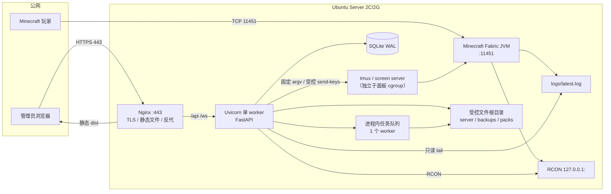
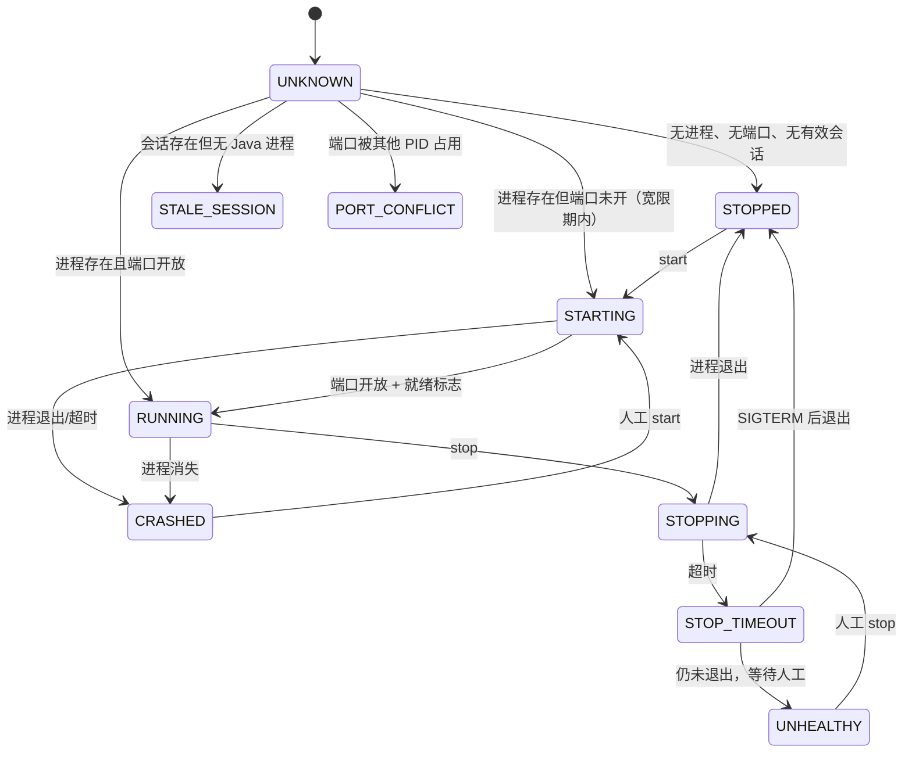

# Minecraft Java 服务器 Web 管理面板 — 工程设计文档

> **文档状态**：v1.0-draft，设计评审稿，尚未开始编码  
> **目标环境**：腾讯云 Ubuntu Server / 2 vCPU / 2 GB RAM / Fabric / 现有 screen 或 tmux 会话 / 游戏端口 11451  
> **核心约束**：不破坏、不重装、不迁移现有 Minecraft 服务端；不向网页暴露任意 Shell；所有未确认的路径、启动命令、会话名、Minecraft 版本均以占位符表示，必须由现场探测确认。

---

## 0. 结论摘要

### 0.1 推荐架构

```text
玩家 ──TCP 11451──> Minecraft Fabric JVM
                         │
                         ├── logs/latest.log
                         └── RCON 127.0.0.1:<RCON_PORT>（仅本机，防火墙拒绝外网）

管理员 ──HTTPS 443──> Nginx ──> Vue 3 静态文件
                         ├── /api/* ──> Uvicorn（单 worker，Unix Socket 或 127.0.0.1）
                         └── /ws     ──> Uvicorn WebSocket

Uvicorn ──> SQLite（WAL）
        ──> 固定适配器（tmux / screen / RCON / 未来的 systemd）
        ──> 受控文件根目录（服务器目录、备份目录、整合包目录）
```

**关键选择：**

1. **Nginx + Vue 静态文件 + 单个 Uvicorn worker + SQLite**。不使用 Redis、PostgreSQL、Celery、Docker、生产环境 Node.js。前端在 CI/本地构建，服务器只托管 `dist/`。
2. **面板只做控制客户端，不拥有 Minecraft JVM**。Minecraft 继续由现有 tmux/screen 会话（或未来的 systemd 单元）托管；面板重启不应杀死游戏服。
3. **控制台命令优先且默认只走 RCON**。tmux 仅用于受控的启动和“已确认 java 前台进程”的停止兜底；screen 不做盲目的 `stuff` 注入。
4. **启动入口是 root 持有的固定 launcher（内部 argv 固定），不由网页提交**。网页只能选择已配置的 profile，不能提交任意命令、参数或 Shell 片段。
5. **所有文件操作以“根目录别名 + 相对路径”表达**，服务端做规范化、符号链接拒绝和逐级 `O_NOFOLLOW` 打开；上传先落临时文件，校验后原子替换。
6. **新 Mod 默认进入禁用区，不自动加载**。启用、删除、重启均需要显式操作和审计。
7. **破坏性操作必须二次确认、优先自动备份、可回滚**。恢复世界要求服务器已停止，并保留恢复前快照。
8. **2 GB 内存是硬约束**。面板自身目标为空闲 80–130 MB、峰值不超过 250 MB；Minecraft 堆建议不超过 1 GB，且必须实测。重整合包应升级到 4 GB。

### 0.2 2 GB 环境下的结论

| 项目 | 估算 | 结论 |
|---|---|---|
| Ubuntu 基础系统（含云厂商 agent） | 250–450 MB | 以现场 `free -m` 为准 |
| Minecraft 1 GB 堆 | 约 1.2–1.5 GB RSS | 加上 Metaspace、直接内存、线程栈 |
| 面板（FastAPI/Uvicorn/SQLite/psutil） | 空闲 80–130 MB，峰值 180–250 MB | 单 worker、无重型依赖 |
| Nginx（1 worker） | 10–20 MB | 静态文件 + 反代 |
| 日志环形缓冲 + WebSocket 队列 | 5–15 MB | 必须设上限 |
| **合计** | **约 1.7–2.0 GB** | **仅适合轻量整合包；必须留 150–250 MB 余量** |

**结论：** 如果现有 Minecraft 已经使用 1.5 GB 堆并稳定运行，直接加面板很可能触发 OOM 或频繁 swap。应先做只读资源基线测量，再决定是否把堆降到 1–1.2 GB，或升级到 4 GB。**不要在未确认前修改现有 JVM 参数。**

### 0.3 必须先确认的未知项

以下值在本文中一律使用 `<...>` 占位，Codex 不得自行假设：

| 未知项 | 为什么必须确认 | 确认方式 |
|---|---|---|
| `<SERVER_USER>` | 面板以哪个 Unix 用户运行，决定文件权限和 tmux/screen 可达性 | `ps -o user= -p <java_pid>` |
| `<SERVER_DIR>` | 所有文件、日志、Mod、世界的根 | `/proc/<java_pid>/cwd`、启动命令、`server.properties` 所在目录 |
| `<SESSION_TYPE>` / `<SESSION_NAME>` / `<WINDOW_NAME>` | 控制方式与防误注入 | `tmux list-sessions` / `screen -ls` / 进程树 |
| `<LAUNCH_ARGV>` 或 `<LAUNCH_SCRIPT>` | 启动必须复用现有方式 | `/proc/<java_pid>/cmdline` + 管理员确认 |
| `<JAVA_BIN>` / Java 版本 | 启动与兼容性 | `readlink -f /proc/<pid>/exe`、`java -version` |
| `<MC_VERSION>` / `<FABRIC_LOADER_VERSION>` | 整合包元数据，不能猜 | `logs/latest.log`、Fabric 安装目录/启动日志 |
| `<WORLD_NAME>` / 额外维度目录 | 备份与恢复范围 | `server.properties` 的 `level-name`、目录检查 |
| `<RCON_PORT>` / RCON 是否启用 | 控制台与状态采集 | `server.properties`（密码必须脱敏）、`ss -ltnp` |
| `<PANEL_DOMAIN>` / TLS 方式 | Cookie、Origin、WebSocket 校验 | 管理员提供 |
| 备份盘路径与可用空间 | 防止备份写满根分区 | `df -h`、`findmnt` |
| 是否允许短暂停机做冷备份 | 备份一致性策略 | 管理员决策 |
| 面板与 MC 是否同用户 | 决定安全隔离级别 | 管理员决策，见 5.10 |

---

# 1. 技术架构

## 1.1 总体架构图



**信任边界：**

- 公网只能访问 `443` 和 `11451`；`22` 限制来源 IP；`25575`（或实际 RCON 端口）和面板后端端口禁止公网访问。
- Nginx 是唯一 HTTP 入口；FastAPI 不直接监听公网。
- 目标部署要求面板进程和 Minecraft 进程都不是 root；如果现场 Minecraft 以 root 运行，先停下来做迁移方案，不能直接在 root 上加面板。
- RCON 是明文协议，只允许本机/专用内网，必须防火墙阻断外网。

## 1.2 组件职责

| 组件 | 职责 | 明确不负责 |
|---|---|---|
| Nginx | TLS 终止、静态文件、反向代理、WebSocket upgrade、请求体大小/速率限制、安全响应头 | 不执行任何业务逻辑，不直接读服务器目录 |
| Vue 3 SPA | 登录、仪表盘、控制台、文件/Mod/备份/整合包界面、确认交互、WebSocket 重连 | 不保存长期密钥，不直接访问 Minecraft/RCON |
| FastAPI | 鉴权、授权、CSRF、参数校验、业务编排、审计、任务调度、WebSocket Hub | 不暴露通用 Shell，不接受任意命令/路径 |
| 控制适配器 | tmux/screen/RCON/未来 systemd 的固定能力封装 | 不做业务判断，不拼接 Shell 字符串 |
| SQLite | 用户、会话、审计、Mod 索引、备份/整合包元数据、任务、分享令牌 | 不作为服务器文件的唯一真相；文件系统仍是 Mod/备份/整合包的真相 |
| 进程内任务队列 | 备份、恢复、整合包构建、扫描等长任务，单并发 | 不做分布式调度，不跨机器 |
| systemd | 面板生命周期、日志、重启、基础沙箱 | 不托管 Minecraft（MVP 阶段） |

## 1.3 技术选型与理由

### 后端

- **Python 3.11/3.12 + FastAPI + Uvicorn，单 worker**。  
  单 worker 是刻意选择：进程内状态、文件锁、WebSocket Hub、任务队列都假设只有一个进程。多 worker 会引入重复调度、锁竞争和 WebSocket 广播不一致。若未来需要多 worker，必须先把状态外置到 Redis/DB 队列，这不是 MVP 范围。
- **SQLAlchemy 2.x + Alembic + SQLite（WAL）**。  
  低并发管理面板足够；迁移可追踪；避免 PostgreSQL 的内存和运维成本。SQLite 设 `busy_timeout`、`foreign_keys=ON`、`synchronous=NORMAL`、合理的 `cache_size`。
- **Argon2id**（`argon2-cffi`）做密码哈希；不保存明文/可逆密码。
- **psutil** 读取进程/系统指标；**不引入 Prometheus/Grafana**。
- **标准库 `tarfile` + `zipfile` + `hashlib`** 做归档；MVP 用 `tar.gz`（压缩级别 1）换取实现简单和内存可控，后续可评估 zstd。
- **标准库 `logging` + JSON 格式化**；不引入重量级日志框架。
- **单进程内 `asyncio.Queue` 任务队列**；任务状态持久化到 SQLite，进程重启后把未完成任务标记为 `interrupted`，不自动恢复。

### 前端

- **Vue 3 + TypeScript + Vite + Tailwind CSS + Pinia + Vue Router**。
- 不引入 Element Plus/Ant Design 等大体积组件库；用 Tailwind + 少量无头组件自建，控制首屏体积。
- 图标使用内联 SVG 或按需引入；图表使用轻量 SVG sparkline，不引入 Chart.js/ECharts。
- 日志列表做窗口化/上限截断，避免 2000+ 行 DOM 拖垮低配客户端。
- 前端构建产物由 Nginx 托管；服务器不安装 Node.js。

### 明确不引入

Redis、PostgreSQL、Celery、RabbitMQ、Docker、Kubernetes、Elasticsearch、Prometheus、Grafana、Sentry 云端 SDK、生产环境 Node runtime、Jupyter、通用 Web SSH/终端。

## 1.4 部署拓扑与端口

| 端口 | 用途 | 暴露范围 | 备注 |
|---|---|---|---|
| 22 | SSH | 仅管理员固定 IP / 跳板机 | 禁用密码登录，使用密钥 |
| 80 | HTTP | 公网 | 仅 301 到 443 |
| 443 | 面板 HTTPS | 公网或 VPN | Nginx |
| 11451 | Minecraft | 公网 | 现有游戏端口，不变 |
| `<RCON_PORT>` | RCON | **仅 127.0.0.1 / 内网** | 防火墙/安全组拒绝公网 |
| 面板后端端口 | FastAPI | 仅本机 | 优先 Unix Socket；退而求其次 127.0.0.1 |

**腾讯云安全组 + UFW 双层限制。** 修改防火墙前先确认 SSH 规则，避免把自己锁在外面。

## 1.5 资源消耗评估（2 GB 重点）

### 1.5.1 内存预算

```text
总内存                                     2048 MB
├─ Ubuntu + systemd + journald + sshd      250–450 MB
├─ Minecraft JVM（-Xmx1024M）              1200–1500 MB
├─ 面板（FastAPI/Uvicorn/SQLite/psutil）     80–130 MB（空闲）
├─ Nginx（1 worker）                          10–20 MB
├─ 日志环 + WS 缓冲 + 页缓存                  20–60 MB
└─ 安全余量                                  150–250 MB
```

- 面板空闲目标：**≤ 130 MB RSS**；峰值（Argon2 登录、ZIP 构建、上传）目标：**≤ 250 MB**。
- 日志环形缓冲建议 1000–2000 行，单行截断 4 KB；WebSocket 每连接队列上限 300 条，慢客户端丢弃最旧日志并提示 `dropped`。
- 上传/下载必须流式，禁止 `await file.read()` 整个文件；禁止把世界/整合包读入内存。
- 压缩任务单并发；压缩/归档放在独立子进程中再执行 `nice -n 19`/`ionice -c 3`，不要直接降低面板主进程优先级，避免 API/WebSocket 一起变慢。
- SQLite 页缓存限制在 8–16 MB；不要设置无限缓存。

### 1.5.2 关键陷阱：cgroup、MemoryMax 与 tmux

这是 2 GB 部署最容易踩的坑：

1. 如果 `mc-panel.service` 设置了 `MemoryMax=256M`，而面板又启动了 tmux/screen server 或 Minecraft 作为其子进程，**Java 会被算进面板 cgroup，可能被 256 MB 限制直接 OOM kill**。
2. 如果 systemd 使用默认 `KillMode=control-group`，停止/重启面板会杀掉同一 cgroup 内的 tmux server 和 Minecraft。
3. 因此必须先确定“谁拥有 JVM”：
   - **MVP 附加模式**：Minecraft 的 tmux/screen server 必须已经存在，并且位于面板 cgroup 之外；面板只是向已存在的 server 新建 session/window，或发送 RCON。面板不负责创建 multiplexer server。
   - 如果 multiplexer server 不存在，不要让面板“顺手创建一个”；应由独立 unit/固定的 root helper 在 `minecraft.slice` 中创建，或由管理员在 SSH 中按固定脚本启动。
   - 在无法证明 Java 位于独立 cgroup 前，**不要给面板设置硬性 `MemoryMax`/`CPUQuota`**；只开 `MemoryAccounting=true`、`Nice=5`，用监控告警。否则可能“面板没崩，游戏服被面板的限额杀了”。
   - 若使用 systemd 托管 Minecraft（后续推荐），必须使用独立 unit 和独立 slice，面板通过受控方式启停，不能把 Java 放进面板 unit。
4. MVP 可设置 `KillMode=process` 降低“停面板连带杀游戏服”的风险，但这只是缓解，不是正确隔离；长期仍应使用独立 supervisor。

> **设计原则：面板绝不拥有 JVM。** 面板是控制客户端，不是 Minecraft 的父进程/进程管理器。

### 1.5.3 CPU、磁盘、网络

- CPU：面板空闲 < 2%；日志 tail 采样 < 1%；压缩/备份可占满 1 核，必须 `nice` 且单任务。2 vCPU 足够，但要避免“备份 + 整合包构建 + 玩家高峰”同时发生。
- 磁盘：备份通常是世界的 2–3 倍（含压缩和保留份数）；整合包约为 Mod 总大小的 1 倍；上传临时文件需要额外空间。每次大任务前检查 `statvfs`，要求至少 `2 × 预估大小 + 512 MB` 余量。
- 网络：整合包下载可能占满云服务器带宽，Nginx 可设置 `limit_rate` 或按 token 限速；Minecraft 玩家流量与面板流量隔离。
- 页缓存：备份/打包会占页缓存，但可回收；不要把它误判为匿名内存泄漏。

### 1.5.4 建议的观测命令（只读）

```bash
free -m
ps -o pid,ppid,user,rss,%cpu,etime,args -p <java_pid>
systemd-cgtop -m
df -h
ss -ltnp
journalctl -u mc-panel --since "1 hour ago"
dmesg -T | grep -i -E 'oom|killed process'
```

## 1.6 “未知环境”处理策略：先探测，后配置

### 1.6.1 只读探测（C00）

在任何写操作之前，执行只读探测并生成 `docs/DISCOVERY.md`：

- OS、内核、架构、cgroup v1/v2、内存/swap、磁盘/挂载点、文件系统类型。
- Java 进程：PID、用户、`/proc/<pid>/cwd`、`/proc/<pid>/cmdline`、启动时间、RSS、监听端口。
- 会话：`tmux list-sessions`、`tmux list-panes -a -F ...`、`screen -ls`、进程树（screen/tmux → java）。
- 端口：谁监听 11451；是否可本地 TCP 连接。
- 服务器目录候选：Java cwd、`server.properties`、`logs/latest.log`、`mods/`、世界目录。
- `server.properties` 脱敏读取：`level-name`、`max-players`、`server-port`、`enable-rcon`、`rcon.port`、`online-mode`；**绝不输出 `rcon.password`**。
- Fabric/MC 版本：启动日志、Fabric loader 目录、jar 名称；无法确定则标记 `UNKNOWN`。
- Mod 数量、是否有禁用目录、世界大小、现有备份/ cron、磁盘余量。
- 现有 systemd unit、sudo 权限、面板用户候选、目录权限。
- RCON 仅做 TCP 连通性检查；密码只由管理员在配置文件中提供。

### 1.6.2 配置来源：root 持有的 profile 文件

执行参数（路径、会话名、启动入口、RCON 密钥位置）放在 root 持有的配置中，面板只读：

```toml
# /etc/mc-panel/profiles/main.toml   （示例，所有 <...> 必须替换）
# owner root:<panel_group>, mode 0640；面板无写权限

[profile]
id = "main"
display_name = "<DISPLAY_NAME>"
adapter = "tmux"                 # tmux | screen | systemd（未来）
server_dir = "<SERVER_DIR>"
session_name = "<SESSION_NAME>"
window_name = "<WINDOW_NAME>"    # 仅 tmux
log_file = "<SERVER_DIR>/logs/latest.log"
launch_entrypoint = "<ROOT_OWNED_LAUNCHER>"  # 固定、不可由网页修改
startup_timeout_sec = 180
stop_timeout_sec = 120

[transport]
console = "rcon"                 # rcon | none
allow_tmux_stop_fallback = true  # 仅在 pane 当前命令确认为 java 时

[rcon]
host = "127.0.0.1"
port = <RCON_PORT>
password_file = "/etc/mc-panel/secrets/rcon.password"

[tps]
enabled = true
provider = "spark"              # spark | carpet | none；不支持则显示 N/A
command = "spark tps"

[world]
level_name = "<WORLD_NAME>"
extra_world_dirs = []

[limits]
max_upload_mb = 256
max_archive_uncompressed_mb = 4096

[files.roots]
server = { path = "<SERVER_DIR>", mode = "ro" }
mods = { path = "<SERVER_DIR>/mods", mode = "ro" }
"mods-disabled" = { path = "<SERVER_DIR>/mods-disabled", mode = "rw" }
config = { path = "<SERVER_DIR>/config", mode = "rw" }
world = { path = "<SERVER_DIR>/<WORLD_NAME>", mode = "ro" }
backups = { path = "/var/backups/mc-panel", mode = "ro" }
packs = { path = "/var/lib/mc-panel/packs", mode = "ro" }
```

**为什么不在网页里编辑 `launch_entrypoint`：** 那等于把“任意命令执行”包装成配置项。网页只能查看脱敏后的 profile、选择已存在的 profile；修改必须 SSH + 重启面板。`launch_entrypoint` 必须是 root 持有、不可被 Minecraft/面板用户写入的固定脚本或可执行文件，脚本内部 `exec` 到固定 Java 命令。

如果现有启动脚本必须由 Minecraft 用户维护，不能直接把它当作安全边界：至少保证面板 API 不能修改它，并接受“同用户可改写启动脚本”的残余风险；更好的做法是创建一个 root 持有的 wrapper，内部 `exec` 固定的 Java argv，或只调用一个不可被 MC 用户写入的脚本。无论哪种方式，都**不能以 root 运行 Minecraft**。

---

# 2. 项目目录结构

```text
mc-panel/
├─ README.md
├─ LICENSE
├─ .gitignore
├─ .editorconfig
├─ Makefile
├─ docs/
│  ├─ DISCOVERY.md                 # C00 现场探测结果（脱敏）
│  ├─ ARCHITECTURE.md              # 本文的精简版/维护版
│  ├─ SECURITY.md                  # 威胁模型与安全基线
│  ├─ API.md                       # 由 OpenAPI 生成/校验
│  ├─ DEPLOY.md                    # 部署、升级、回滚
│  ├─ RUNBOOK.md                   # 故障处置与恢复演练
│  └─ adr/
│     ├─ 0001-control-transport.md
│     ├─ 0002-deployment-isolation.md
│     ├─ 0003-backup-consistency.md
│     └─ 0004-resource-budget.md
├─ backend/
│  ├─ pyproject.toml
│  ├─ uv.lock                      # 或 requirements.lock，二选一，必须锁定
│  ├─ alembic.ini
│  ├─ migrations/
│  │  └─ versions/
│  ├─ app/
│  │  ├─ main.py                   # app factory、生命周期、路由挂载
│  │  ├─ cli.py                    # create-admin、rotate-secret、check-config
│  │  ├─ core/
│  │  │  ├─ config.py              # 环境变量 + root profile 读取
│  │  │  ├─ logging.py             # JSON 日志、request_id
│  │  │  ├─ errors.py              # RFC 7807 错误模型
│  │  │  ├─ security.py            # 密码、token、CSRF、Origin
│  │  │  ├─ rate_limit.py          # 内存令牌桶
│  │  │  ├─ locks.py               # flock + asyncio.Lock
│  │  │  └─ redaction.py           # 日志/审计脱敏
│  │  ├─ db/
│  │  │  ├─ base.py
│  │  │  ├─ models.py
│  │  │  ├─ session.py
│  │  │  └─ repositories/
│  │  ├─ api/
│  │  │  ├─ deps.py                # 当前用户、权限、CSRF、DB
│  │  │  └─ v1/
│  │  │     ├─ auth.py
│  │  │     ├─ server.py
│  │  │     ├─ console.py
│  │  │     ├─ mods.py
│  │  │     ├─ files.py
│  │  │     ├─ backups.py
│  │  │     ├─ packs.py
│  │  │     ├─ jobs.py
│  │  │     ├─ audit.py
│  │  │     ├─ system.py
│  │  │     └─ public.py
│  │  ├─ ws/
│  │  │  ├─ endpoint.py
│  │  │  ├─ hub.py
│  │  │  └─ protocol.py
│  │  ├─ services/
│  │  │  ├─ auth.py
│  │  │  ├─ profile.py
│  │  │  ├─ process.py
│  │  │  ├─ state.py
│  │  │  ├─ control.py
│  │  │  ├─ rcon.py
│  │  │  ├─ logs.py
│  │  │  ├─ metrics.py
│  │  │  ├─ files.py
│  │  │  ├─ mods.py
│  │  │  ├─ backups.py
│  │  │  ├─ packs.py
│  │  │  ├─ jobs.py
│  │  │  └─ audit.py
│  │  ├─ adapters/
│  │  │  ├─ base.py               # ProcessController / Multiplexer 接口
│  │  │  ├─ tmux.py
│  │  │  ├─ screen.py
│  │  │  ├─ systemd.py            # 预留，不在 MVP
│  │  │  └─ fake.py               # 仅测试
│  │  ├─ schemas/
│  │  └─ utils/
│  │     ├─ paths.py              # 路径根、逐级 nofollow
│  │     ├─ archives.py           # zip/tar 安全解包
│  │     ├─ hashing.py
│  │     └─ time.py
│  └─ tests/
│     ├─ unit/
│     ├─ integration/
│     ├─ security/
│     └─ fixtures/
├─ frontend/
│  ├─ package.json
│  ├─ vite.config.ts
│  ├─ tailwind.config.ts
│  ├─ tsconfig.json
│  ├─ index.html
│  ├─ src/
│  │  ├─ main.ts
│  │  ├─ App.vue
│  │  ├─ router/
│  │  ├─ stores/                  # auth、server、console、jobs
│  │  ├─ api/                     # fetch 封装、CSRF、错误映射
│  │  ├─ ws/                      # 连接、ticket、重连、订阅
│  │  ├─ components/
│  │  ├─ views/
│  │  │  ├─ LoginView.vue
│  │  │  ├─ DashboardView.vue
│  │  │  ├─ ConsoleView.vue
│  │  │  ├─ ModsView.vue
│  │  │  ├─ FilesView.vue
│  │  │  ├─ BackupsView.vue
│  │  │  ├─ PacksView.vue
│  │  │  └─ AuditView.vue
│  │  ├─ composables/
│  │  ├─ styles/
│  │  └─ types/
│  └─ tests/
├─ deploy/
│  ├─ nginx/mc-panel.conf
│  ├─ systemd/mc-panel.service
│  ├─ bin/mcpanel-ctl            # 隔离模式下的固定 helper（P1）
│  ├─ install.sh
│  ├─ upgrade.sh
│  ├─ rollback.sh
│  ├─ uninstall.sh
│  ├─ backup-db.sh
│  └─ env.example
├─ scripts/
│  ├─ discover.sh                # 只读探测
│  ├─ dev.sh
│  └─ smoke-test.sh
├─ .github/workflows/ci.yml
└─ var/                           # 本地开发运行时，生产不使用仓库内目录
   ├─ panel.db
   ├─ uploads/
   ├─ tmp/
   ├─ trash/
   ├─ packs/
   └─ backups/
```

**生产运行时目录（与代码分离）：**

```text
/opt/mc-panel/current/            # 发布软链接
/opt/mc-panel/releases/<ver>/
/opt/mc-panel/venv/
/etc/mc-panel/
  ├─ panel.toml
  ├─ profiles/main.toml
  ├─ secrets/rcon.password        # 0600
  └─ panel.env                    # 0600
/var/lib/mc-panel/
  ├─ panel.db
  ├─ uploads/
  ├─ tmp/
  ├─ trash/
  └─ packs/
/var/backups/mc-panel/            # 世界备份，独立分区更佳
/var/log/mc-panel/
/var/www/mc-panel/                # 前端 dist
/run/mc-panel/                    # socket / lock
```

**Minecraft 服务器目录不在仓库中，也不由安装脚本创建或覆盖。**

---

# 3. 模块与 API 设计

## 3.1 API 通用约定

- 基础路径：`/api/v1`；WebSocket：`/ws`。
- 编码：JSON UTF-8；时间统一 UTC ISO 8601；大小统一字节；ID 使用 UUID/ULID。
- 鉴权：HttpOnly 会话 Cookie + 所有非 GET 请求的 `X-CSRF-Token`；不使用 localStorage 存长期 token。
- 授权：权限 scope 校验；MVP 只有 `admin`，但接口从第一天按 scope 设计。
- 长任务：返回 `202 Accepted` + `{job_id}` + `Location: /api/v1/jobs/{id}`；进度通过 WebSocket `jobs` 主题推送，也可轮询。
- 幂等：控制、备份、构建等 POST 支持 `Idempotency-Key`；相同 key + 相同用户 + 相同路径在 24 小时内返回原结果，防止双击/重试重复启动。
- 分页：`limit`（默认 50，最大 200）+ `cursor`；返回 `{items, next_cursor}`。
- 错误：RFC 7807 风格：

```json
{
  "type": "https://panel.example/errors/conflict",
  "title": "服务器已在运行",
  "status": 409,
  "code": "SERVER_ALREADY_RUNNING",
  "detail": "检测到 PID 1234 正在监听 11451。",
  "request_id": "01J..."
}
```

- OpenAPI：开发环境可访问 `/docs`；生产环境由 Nginx 屏蔽或仅管理员访问。
- CORS：默认关闭（同源部署）；开发环境只允许显式 `http://localhost:<port>`。
- 所有响应带 `X-Request-ID`；不向前端返回堆栈、绝对路径、RCON 密码。
- 路由顺序：`/mods/scan`、`/mods/trash`、`/packs/preview`、`/packs/client-extras`、`/backups/policy` 等字面量路由必须注册在 `/{id}` 之前；路径参数用 UUID 校验，避免把 `preview` 当成 ID。

### 3.1.1 权限 scope 与角色

MVP 只有 `admin` 用户，但后端从第一天按 scope 校验，后续加角色不需要改业务代码。

| scope | 含义 |
|---|---|
| `server.view` | 查看状态、玩家、指标、profile（脱敏） |
| `server.control` | start/stop/restart/force-stop |
| `console.read` | 查看日志/历史 |
| `console.write` | 发送服务器命令 |
| `files.read` | 浏览/下载/预览 |
| `files.write` | 上传/创建/重命名/移动/删除 |
| `mods.read` | 查看 Mod/依赖/问题 |
| `mods.write` | 上传/启停/删除/回收站 |
| `backups.read` | 查看/下载/校验备份 |
| `backups.write` | 创建备份 |
| `backups.admin` | 恢复/删除备份/修改保留策略 |
| `packs.read` | 查看/下载整合包 |
| `packs.write` | 构建/分享/删除整合包/管理覆盖 |
| `audit.read` | 查看审计 |
| `settings.admin` | 修改非执行设置 |
| `users.admin` | 用户/角色管理（P1） |

| 角色 | scope |
|---|---|
| `viewer` | `server.view`, `console.read`, `files.read`, `mods.read`, `backups.read`, `packs.read` |
| `operator` | viewer + `server.control`, `console.write`, `files.write`, `mods.write`, `backups.write`, `packs.write`（不含恢复/删除备份） |
| `admin` | 全部 scope |

> 所有 API 的“权限”列是设计意图；实现时统一用 `require_scope("...")` 依赖，不在路由内手写角色判断。

## 3.2 鉴权与会话 API

| 方法 | 路径 | 权限 | 说明 |
|---|---|---|---|
| POST | `/auth/login` | 公开 | `{username,password,totp_code?}`；成功设置 `__Host-mcpanel_session`，返回 `{user, csrf_token, expires_at}`；失败统一 401，限流 |
| POST | `/auth/logout` | 登录 + CSRF | 撤销当前会话 |
| GET | `/auth/me` | 登录 | 返回用户、权限、CSRF token、会话过期时间 |
| POST | `/auth/ws-ticket` | 登录 + CSRF | 生成一次性 30 秒 WebSocket ticket |
| POST | `/auth/password` | 登录 + CSRF | 修改密码；撤销其他会话 |
| GET | `/auth/sessions` | 登录 | 当前用户会话列表 |
| DELETE | `/auth/sessions/{id}` | 登录 + CSRF | 撤销指定会话 |
| POST | `/auth/totp/setup` | 登录 + CSRF | P1：生成 TOTP secret/二维码 |
| POST | `/auth/totp/verify` | 登录 + CSRF | P1：启用 TOTP，返回恢复码 |

**登录安全细节：**

- 用户名不存在与密码错误返回同一错误、近似耗时；失败审计。
- 登录接口不要求预认证 CSRF，但必须校验 `Origin`/`Referer` 与 `MC_PANEL_PUBLIC_ORIGIN` 一致，防止 login CSRF；无 Origin 的非浏览器客户端按拒绝处理。
- 登录限流：每 IP 5 次/分钟、每用户名 10 次/小时；指数退避；不使用永久锁号（避免 DoS）。
- 密码最小 12 字符，拒绝与用户名相同/常见弱口令；管理员通过 CLI 创建，不设默认密码。
- Cookie：`__Host-mcpanel_session`，`Secure; HttpOnly; SameSite=Strict; Path=/`；生产必须 HTTPS。
- 会话：随机 32 字节 token，数据库只存 SHA-256；空闲 8 小时、绝对 7 天；登录时轮换会话 ID。
- Argon2id 参数在 2 GB 环境建议 `m=32–64 MiB, t=3, p=1`，并限制并发登录尝试；不要用过高内存参数导致与 Minecraft 争抢内存。
- CSRF token 与 session 绑定，登录后通过 `/auth/me` 返回；前端内存保存，刷新后重新获取。
- TOTP secret 使用面板主密钥加密后存储；主密钥由 `/etc/mc-panel/secrets/panel.key` 提供（`MC_PANEL_SECRET_KEY_FILE` 指向它），0600/0640，不入库。

## 3.3 服务器状态与指标 API

| 方法 | 路径 | 权限 | 说明 |
|---|---|---|---|
| GET | `/server/status` | `server.view` | 完整状态快照 |
| GET | `/server/players` | `server.view` | 在线玩家；明确区分“0 人”和“未知” |
| GET | `/server/metrics?window=1h` | `server.view` | 内存中的指标序列（CPU/RSS/在线数/TPS） |
| GET | `/server/capabilities` | `server.view` | 当前适配器支持哪些操作，以及原因 |
| GET | `/server/logs?cursor=&limit=200` | `console.read` | 历史日志分页 |
| GET | `/server/profile` | `server.view` | 脱敏 profile（不含密码/密钥） |

**状态响应示例：**

```json
{
  "profile": {"id": "main", "display_name": "生存服", "adapter": "tmux"},
  "state": "RUNNING",
  "health": "HEALTHY",
  "pid": 1234,
  "started_at": "2025-01-01T10:00:00Z",
  "uptime_seconds": 3600,
  "port": 11451,
  "port_open": true,
  "players": {"online": 2, "max": 20, "names": ["Alice", "Bob"], "source": "rcon"},
  "tps": {"available": true, "value": 19.8, "source": "spark", "sampled_at": "..."},
  "cpu": {"process_percent_1core": 12.3, "system_percent": 25.0, "load_1m": 0.8},
  "memory": {
    "process_rss_bytes": 1320000000,
    "system_total_bytes": 2147483648,
    "system_available_bytes": 320000000
  },
  "disk": {"server_free_bytes": 18000000000, "backup_free_bytes": 9000000000},
  "capabilities": {
    "console_write": true,
    "start": true,
    "stop": true,
    "restart": true,
    "tps": true
  },
  "warnings": [
    "TPS 来源为 Spark；未安装时该项显示不可用，不会伪造 20.0。"
  ]
}
```

**状态语义：**

- `state`：`UNKNOWN | STOPPED | STARTING | RUNNING | STOPPING | CRASHED | UNHEALTHY | STALE_SESSION | PORT_CONFLICT`。
- `health`：`HEALTHY | DEGRADED | UNHEALTHY | UNKNOWN`。
- 在线人数：优先 RCON `list`；RCON 不可用时才用日志 join/leave 推算，并标记 `source=log`、可能不准确；完全未知返回 `online: null`，不要返回 0。
- TPS：Fabric 原版没有通用 TPS 命令。可选来源：Spark 的 `spark tps`、Carpet 的 `tps`、其他 Mod 的 RCON 命令。profile 中配置命令与正则；启动后能力探测；不支持则 `available:false` + `reason`。**不得用日志里的 “Can't keep up” 直接冒充当前 TPS。**
- CPU：`process_percent_1core` 表示相对单核的百分比（可超过 100）；同时给系统总 CPU 百分比。文档和 UI 必须标注口径。
- 内存：只承诺进程 RSS 和系统可用内存；没有 JMX 就不声称“堆使用率”。

## 3.4 服务器控制 API

| 方法 | 路径 | 权限 | 说明 |
|---|---|---|---|
| POST | `/server/start` | `server.control` | 启动；202 + job；409 表示已在运行/启动中/端口冲突/锁忙 |
| POST | `/server/stop` | `server.control` | 优雅停止；body `{confirm:"STOP"}`；202 |
| POST | `/server/restart` | `server.control` | 停止成功后启动；body `{confirm:"RESTART"}`；202 |
| POST | `/server/force-stop` | `server.control` | 仅在超时后人工升级；body 需 `confirm:"FORCE STOP"` + `expected_pid` + `expected_started_at`；审计 |

**约束：**

- 启动前必须做幂等/防重检查（见 4.5）。
- 停止优先 RCON `stop`；tmux 兜底只在 `pane_current_command` 确认为 java 时发送固定字面量 `stop`；screen 不做盲目注入。
- 超时后不自动 `kill -9`；只允许管理员显式升级为 SIGTERM/强制停止，并记录原因。
- 重启不是“先启动再停止”；必须停止确认后再启动。
- `confirm` 由服务端校验，不能只靠前端按钮。

## 3.5 控制台与 WebSocket

### REST 命令接口

| 方法 | 路径 | 权限 | 说明 |
|---|---|---|---|
| POST | `/console/commands` | `console.write` | `{command, request_id?}`；同步等待 RCON 响应或超时 |
| GET | `/console/history` | `console.read` | P1；最近命令审计（脱敏） |

**命令校验：**

- 去掉开头 `/`；拒绝 `\r`、`\n`、NUL、其他控制字符；长度 ≤ 256。
- 拒绝空命令；拒绝 `stop`（引导使用 `/server/stop`，保证状态机一致）；`restart` 不是原版命令，但若插件提供，也建议拦截或警告。
- 限流 5 条/秒、突发 10；每条命令写审计（敏感命令脱敏）。
- RCON 超时返回 504，并明确提示“命令可能已执行，不要自动重试”；服务端不自动重试。
- 绝不把命令拼接进 Shell；任意控制台命令只作为 RCON 数据包发送。tmux `send-keys -l` 仅用于固定字面量 `stop` 的兜底，不作为任意命令通道。

### WebSocket 端点

`/ws`，单连接多主题，减少连接数。

**握手与鉴权：**

1. 浏览器先 `POST /auth/ws-ticket`（需登录 + CSRF），获得一次性 ticket（30 秒、单次使用、绑定 session/user）。
2. `new WebSocket("/ws")`；浏览器自动携带 Cookie。
3. 服务端校验：会话 Cookie 有效、`Origin` 等于配置的 `public_origin`、连接数未超限。
4. 客户端在 5 秒内发送首帧：

```json
{"type": "auth", "ticket": "<one-time-ticket>"}
```

5. 服务端原子消费 ticket，成功返回：

```json
{"type": "ready", "user": {"id": "...", "username": "admin"}, "topics": ["logs", "status", "jobs"]}
```

6. 失败/超时关闭（4401/4403/1008）。ticket 不放在 URL/query，避免进入 Nginx/代理日志。

**订阅协议：**

```json
{"type": "subscribe", "topics": ["logs", "status", "jobs"], "since_seq": 12345}
```

服务端事件：

```json
{"type":"log","seq":12346,"ts":"...","level":"INFO","line":"...","truncated":false}
{"type":"status","data":{...}}
{"type":"job","data":{"id":"...","status":"running","phase":"archiving","progress":0.42}}
{"type":"log_gap","from":12346,"to":12400}
{"type":"error","code":"RATE_LIMITED","detail":"..."}
```

**限制：**

- 单用户最多 4 个连接，全局最多 20 个；**认证前每 IP 最多 5 个并发连接、每分钟最多 30 次握手**，超限直接拒绝。
- 单帧 ≤ 16 KB；每连接发送队列 ≤ 300 条；慢客户端丢弃最旧日志并发送 `dropped` 计数，持续慢则关闭 1013。
- 30 秒心跳 ping/pong；无 pong 关闭。
- 会话被撤销/过期时服务端主动关闭 4401。
- 日志重放只覆盖环形缓冲（约 1000–2000 行）；超出返回 `log_gap`。
- **WebSocket 不接收控制命令**；命令走 REST，确保 CSRF、幂等、审计一致。
- 订阅主题也要鉴权：`logs` 需要 `console.read`，`status` 需要 `server.view`，`jobs` 只推送当前用户有权查看的任务；不能因为连上 WS 就默认拥有全部读权限。

## 3.6 Mod 管理 API

| 方法 | 路径 | 权限 | 说明 |
|---|---|---|---|
| GET | `/mods?include_disabled=true` | `mods.read` | Mod 列表、元数据、问题、是否需要重启 |
| POST | `/mods/scan` | `mods.write` | 重新扫描 `mods/`、`mods-disabled/`，202 job |
| POST | `/mods/upload` | `mods.write` | 批量 multipart；默认落到禁用区；207 多文件结果 |
| GET | `/mods/{mod_id}` | `mods.read` | 详情、依赖、被依赖、冲突、文件哈希 |
| POST | `/mods/{mod_id}/enable` | `mods.write` | 依赖/环境检查后移动；返回 `restart_required` |
| POST | `/mods/{mod_id}/disable` | `mods.write` | 移动到禁用区；不会热卸载 |
| DELETE | `/mods/{mod_id}` | `mods.write` | 移到回收站；需确认；审计 |
| POST | `/mods/bulk` | `mods.write` | `{action, ids}`；逐项结果 |
| GET | `/mods/trash` | `mods.write` | 回收站 |
| POST | `/mods/trash/{id}/restore` | `mods.write` | 恢复 |

**Mod 响应示例：**

```json
{
  "id": "uuid",
  "filename": "example-1.2.3.jar",
  "sha256": "...",
  "size": 123456,
  "enabled": false,
  "location": "disabled",
  "metadata": {
    "mod_id": "example",
    "name": "Example Mod",
    "version": "1.2.3",
    "environment": "client",
    "depends": {"fabric-api": ">=0.90.0"}
  },
  "issues": [
    {"severity": "warning", "code": "CLIENT_ONLY", "message": "该 Mod 标记为 client，启用后服务端不会加载。"}
  ],
  "restart_required": true
}
```

**关键规则：**

- 上传先写临时文件，校验 ZIP/JAR 签名头（`PK\x03\x04`）、大小、SHA-256，再原子移动到 `mods-disabled/`。
- **绝不自动启用新 Mod**；默认禁用，管理员审核后显式启用。
- 启用/禁用不热加载；UI 显示“重启后生效”，不自动重启服务器。
- 依赖检查只做 best-effort：解析 `fabric.mod.json` 的 `depends`/`breaks`/`provides`，版本约束无法解析时给 warning 而不是假装通过。
- 默认缺依赖/环境不匹配时拒绝启用；管理员可用 `{force:true, reason:"..."}` 强制启用，但需要 `mods.write`、写审计并在 UI 显示风险。`force` 不能绕过“上传后默认禁用”。
- 删除移动到 `mods-trash/<timestamp>/`，保留期可配置；不直接 `unlink`。
- 禁止解压 JAR 到磁盘；只读取 `fabric.mod.json` 单个条目（≤ 1 MB），不解压 class，不加载代码。
- Fabric 的嵌套 `jars` 不递归解析，标为 `NESTED_JARS_NOT_ANALYZED` warning；不假装依赖分析完整。
- 文件名重名：哈希相同则跳过；哈希不同则拒绝或加时间戳，要求管理员确认，不静默覆盖。

## 3.7 文件管理 API

| 方法 | 路径 | 权限 | 说明 |
|---|---|---|---|
| GET | `/files/roots` | `files.read` | 可用根别名与读写能力（不返回可穿越的绝对路径给非管理员） |
| GET | `/files?root=&path=` | `files.read` | 目录列表；不递归；分页 |
| GET | `/files/stat?root=&path=` | `files.read` | 单个文件/目录信息 |
| GET | `/files/download?root=&path=` | `files.read` | 流式下载；`Content-Disposition: attachment` |
| GET | `/files/preview?root=&path=` | `files.read` | 文本预览 ≤ 256 KB；`text/plain; charset=utf-8` |
| POST | `/files/upload?root=&path=&overwrite=false` | `files.write` | 单文件流式上传；临时文件 + 原子替换 |
| POST | `/files/mkdir` | `files.write` | `{root,path,name}` |
| POST | `/files/rename` | `files.write` | `{root,path,new_name}` |
| POST | `/files/move` | `files.write` | `{root,src,dst_dir}` |
| DELETE | `/files?root=&path=&confirm=` | `files.write` | 移到回收站；确认短语 |

**根别名示例（实际以 root 配置为准）：**

| root | 指向 | 默认权限 | 说明 |
|---|---|---|---|
| `server` | `<SERVER_DIR>` | 只读 | 浏览整体结构；不通过此根写入 |
| `mods` | `<SERVER_DIR>/mods` | 只读 | 只读浏览；写入必须走 Mod API，确保“默认禁用”不被绕过 |
| `mods-disabled` | `<SERVER_DIR>/mods-disabled` | 读写 | 禁用区；仍建议走 Mod API |
| `config` | `<SERVER_DIR>/config` | 读写 | 配置；预览不内联渲染 |
| `world` | `<SERVER_DIR>/<WORLD_NAME>` | 只读 | 运行中禁写；备份/恢复期间禁写 |
| `backups` | `/var/backups/mc-panel` | 只读 | 通过备份 API 管理，不建议通用文件写 |
| `packs` | `/var/lib/mc-panel/packs` | 只读 | 通过整合包 API 管理 |

> 根之间可能重叠（`server` 包含 `mods`）。解析时按**路径组件最长前缀**选择最具体的根；写权限取最具体根的配置，不能借 `server` 父根绕过 `mods` 只读。跨根移动默认拒绝，必须显式复制/确认。

**路径规则：**

- 请求只接受 `root` 别名 + 相对路径；不接受绝对路径。
- 拒绝 `..`、空段、NUL、控制字符、Windows 盘符/UNC、反斜杠；路径长度 ≤ 4096。
- 每个根在启动时 `realpath` 固定；根本身不允许是符号链接（或必须由管理员显式允许并固定解析结果）。
- 逐级用 `O_DIRECTORY|O_NOFOLLOW` 打开；最终文件 `O_NOFOLLOW`；拒绝任何符号链接，避免 `realpath` 检查与使用之间的 TOCTOU。
- 写操作在目标目录内创建 `.upload-<uuid>.part`，`fsync` 后 `os.replace`；失败清理；不产生半文件。
- 下载强制附件，`X-Content-Type-Options: nosniff`；HTML/SVG/XML 不内联渲染。
- 禁止把面板配置、数据库、RCON 密钥、SSH 密钥加入任何文件根。
- `world/` 等存档目录在服务器运行时默认只读展示；写入/删除需要显式风险确认，备份/恢复期间完全禁止写。
- `server.properties` 可被管理员读取，但预览默认脱敏 `rcon.password`；下载敏感文件写审计。

## 3.8 整合包 API

| 方法 | 路径 | 权限 | 说明 |
|---|---|---|---|
| GET | `/packs` | `packs.read` | 已构建整合包列表 |
| GET | `/packs/preview` | `packs.read` | 预览分类：客户端/服务端/两端、缺失依赖、排除项、配置 |
| POST | `/packs/build` | `packs.write` | 202 job；快照当前 Mod 清单并构建 ZIP |
| GET | `/packs/{id}` | `packs.read` | 构建状态、manifest、大小、SHA-256 |
| GET | `/packs/{id}/download` | `packs.read` | 管理员下载 |
| POST | `/packs/{id}/share` | `packs.write` | 生成玩家可用的限时下载 token |
| GET | `/packs/{id}/shares` | `packs.write` | 分享链接列表 |
| DELETE | `/packs/{id}/shares/{share_id}` | `packs.write` | 撤销 |
| DELETE | `/packs/{id}` | `packs.write` | 删除构建产物（确认） |
| GET | `/packs/overrides` | `packs.read` | 每个 Mod 的 include/exclude 覆盖 |
| PUT | `/packs/overrides/{mod_id}` | `packs.write` | 手工纠正 `*` 环境的分类 |
| POST | `/packs/client-extras` | `packs.write` | 上传仅客户端 Mod（小地图、光影辅助等） |
| DELETE | `/packs/client-extras/{id}` | `packs.write` | 删除客户端附加 Mod |

**构建请求示例：**

```json
{
  "name": "生存服客户端包",
  "include_configs": false,
  "config_allowlist": [],
  "include_client_extras": true,
  "notes": "用于 1.0 周目"
}
```

服务端在 job 开始时冻结 Mod 清单；构建期间 `mods.write` 被阻塞，避免“清单是一个版本、文件是另一个版本”。`allow_missing_deps` 不作为默认选项；缺失依赖应先在预览中解决。

**公开下载（无需管理员登录）：**

| 方法 | 路径 | 说明 |
|---|---|---|
| GET | `/public/packs/{token}` | 返回包名、MC/Fabric 版本、大小、SHA-256、过期时间；不暴露服务器路径 |
| GET | `/public/packs/{token}/download` | 流式下载；`Content-Disposition: attachment`；`X-Robots-Tag: noindex` |

**分享 token 规则：**

- 32 字节随机 URL-safe token；数据库只存 SHA-256；默认 7 天过期；可设最大下载次数；可撤销。
- 公开接口限流；不返回目录列表；token 无效/过期统一 404，避免探测。
- 分享链接页面设置 `Referrer-Policy: no-referrer`；Nginx 对该路径关闭 access log 或脱敏 token。
- 包文件存放在 `/var/lib/mc-panel/packs/`，不在 Minecraft 服务器目录，也不在 Nginx 静态根目录。

## 3.9 备份与恢复 API

| 方法 | 路径 | 权限 | 说明 |
|---|---|---|---|
| GET | `/backups` | `backups.read` | 备份列表、大小、校验状态、模式 |
| POST | `/backups` | `backups.write` | `{label, mode: "cold" 或 "hot", include_configs:false}`；202 job |
| GET | `/backups/{id}` | `backups.read` | 详情、manifest 摘要 |
| GET | `/backups/{id}/manifest` | `backups.read` | 文件清单、哈希、世界名 |
| GET | `/backups/{id}/download` | `backups.read` | 管理员流式下载 |
| POST | `/backups/{id}/verify` | `backups.write` | 校验 SHA-256/可读性；202 job |
| POST | `/backups/{id}/restore` | `backups.admin` | 要求已停止；确认短语；先做恢复前备份 |
| DELETE | `/backups/{id}` | `backups.admin` | 删除；确认；至少保留最后一个已验证备份（可配置） |
| GET/PUT | `/backups/policy` | `backups.admin` | P1：保留策略、计划任务 |

**恢复请求示例：**

```json
{
  "confirm": "RESTORE <WORLD_NAME> <BACKUP_ID>",
  "create_pre_restore_backup": true
}
```

**规则：**

- 恢复前必须确认**没有运行中的 Minecraft 进程且端口已释放**（`STOPPED`，或 `CRASHED` 且无进程/无端口）；运行中返回 409，并提示先停止，绝不自动热恢复。
- 恢复只覆盖世界目录；即使备份时 `include_configs=true` 包含了配置，也仅用于下载/人工参考，不自动恢复配置，避免覆盖 RCON/白名单等关键文件。
- 若 `create_pre_restore_backup=true`，先对当前世界做一次冷备份；失败则中止恢复。
- 校验归档 SHA-256 和 manifest；安全解包到临时目录；验证 `level.dat` 可读（gzip + NBT 头）后再切换。
- 切换：当前世界目录原子改名为 `trash/world-<timestamp>`；临时目录 `os.replace` 为世界目录；`fsync` 父目录；失败则回滚改名。
- 恢复完成后**不自动启动**服务器；由管理员启动并验证。保留回滚目录至少 7 天。
- 使用 `restore-state.json` 记录阶段；面板崩溃后启动时检测到标记，禁止新的恢复，提示人工按 RUNBOOK 处理。
- 备份文件权限 0600，目录 0700；下载仅管理员；不做公开分享。

## 3.10 任务、审计、系统 API

| 方法 | 路径 | 权限 | 说明 |
|---|---|---|---|
| GET | `/jobs?status=&type=` | 登录 | 任务列表 |
| GET | `/jobs/{id}` | 登录 | 任务详情、阶段、进度、错误码 |
| POST | `/jobs/{id}/cancel` | 按任务权限 | 仅在安全检查点可取消；恢复切换阶段不可取消 |
| GET | `/audit?actor=&action=&target=&from=&to=` | `audit.read` | 审计查询；管理员 |
| GET | `/system/info` | `admin` | 面板版本、运行时间、RSS、磁盘、能力；不含密钥 |
| GET | `/settings` | `admin` | 安全的非执行配置（保留期、UI 偏好） |
| PUT | `/settings` | `admin` | 只允许白名单字段；不含路径/命令/密钥 |
| GET | `/healthz` | 公开 | 仅 `{"status":"ok"}`；不泄露版本/路径/DB 状态 |

**任务对象示例：**

```json
{
  "id": "01J...",
  "type": "backup.create",
  "status": "running",
  "phase": "archiving",
  "progress": 0.42,
  "created_at": "2025-01-01T10:00:00Z",
  "started_at": "2025-01-01T10:00:01Z",
  "finished_at": null,
  "result": null,
  "error": null
}
```

`status` 枚举：`queued | running | succeeded | failed | cancelled | interrupted`。所有长任务都必须有阶段和进度，前端不能只显示“转圈”。长任务全局并发为 1（备份/恢复/构建/扫描串行），控制请求不被全局任务队列阻塞，但仍会竞争 `server` 锁。

## 3.11 主要错误码

| HTTP | code | 场景 |
|---|---|---|
| 400 | `VALIDATION_ERROR` | 参数格式错误 |
| 401 | `AUTH_REQUIRED` / `AUTH_INVALID` | 未登录/凭证错误 |
| 403 | `CSRF_INVALID` / `FORBIDDEN` / `ORIGIN_DENIED` | CSRF/权限/Origin |
| 404 | `NOT_FOUND` | 资源不存在；公开 token 也统一 404 |
| 409 | `SERVER_ALREADY_RUNNING` | 已运行/启动中 |
| 409 | `SERVER_NOT_RUNNING` | 停止/命令时未运行 |
| 409 | `SERVER_NOT_STOPPED` | 恢复/热操作要求停止 |
| 409 | `CONTROL_BUSY` | 控制锁被占用 |
| 409 | `PORT_CONFLICT` | 端口被其他进程占用 |
| 409 | `STALE_SESSION` | 会话存在但无 Java 进程 |
| 409 | `MOD_DEPENDENCY_MISSING` | 缺少依赖 |
| 409 | `FILE_EXISTS` | 未允许覆盖 |
| 413 | `FILE_TOO_LARGE` | 超过上传限制 |
| 415 | `UNSUPPORTED_FILE_TYPE` | 扩展名/签名不允许 |
| 422 | `PATH_OUTSIDE_ROOT` / `SYMLINK_DENIED` | 路径越界/符号链接 |
| 422 | `ARCHIVE_UNSAFE` | zip slip/链接/设备文件 |
| 429 | `RATE_LIMITED` | 限流 |
| 502 | `RCON_UNAVAILABLE` | RCON 连不上/认证失败 |
| 504 | `RCON_TIMEOUT` | 命令可能已执行，禁止自动重试 |
| 507 | `DISK_FULL` | 空间不足 |
| 500 | `INTERNAL_ERROR` | 统一错误，带 request_id |

## 3.12 数据模型（SQLite）

| 表 | 关键字段 | 说明 |
|---|---|---|
| `users` | id, username, password_hash, role, totp_secret_enc, disabled, created_at | MVP 单管理员，角色字段预留 |
| `sessions` | id, user_id, token_hash, csrf_secret, created_at, last_seen_at, expires_at, revoked_at, ip, user_agent | 只存 token 哈希 |
| `audit_events` | id, ts, actor_id, action, target, result, ip, request_id, details_json | 追加写；不可更新/删除 |
| `mods` | id, sha256, filename, enabled, location, size, metadata_json, issues_json, created_at, updated_at | 文件系统为真相，表为索引 |
| `mod_overrides` | mod_id, action (`include`/`exclude`), reason, updated_by | 整合包分类覆盖 |
| `client_extras` | id, filename, sha256, metadata_json, enabled, created_at | 仅客户端 Mod |
| `packs` | id, name, status, path, size, sha256, manifest_json, created_by, created_at | 构建产物 |
| `pack_shares` | id, pack_id, token_hash, expires_at, max_downloads, download_count, revoked_at | 公开下载 token |
| `backups` | id, label, world_name, mode, status, path, size, sha256, manifest_json, created_by, created_at, verified_at | 备份索引 |
| `jobs` | id, type, status, phase, progress, payload_json, result_json, error_code, created_at, started_at, finished_at | 不存密钥 |
| `settings` | key, value_json | 非执行配置 |
| `idempotency_keys` | key, user_id, endpoint, request_hash, response_json, expires_at | 24 小时 |
| `trash` | id, kind, original_path, trash_path, sha256, created_at, expires_at | 文件/Mod 回收站 |

**SQLite 设置：** WAL、`foreign_keys=ON`、`busy_timeout=5000`、`synchronous=NORMAL`、`cache_size=-8192`；数据库文件 0600，目录 0700；升级前用 `VACUUM INTO` 或文件复制做 DB 备份。

---

# 4. 数据流与服务器控制方案

## 4.1 登录与请求主流程

```mermaid
sequenceDiagram
    participant B as Browser
    participant N as Nginx
    participant A as FastAPI
    participant D as SQLite

    B->>N: POST /api/v1/auth/login (HTTPS)
    N->>A: 反代
    A->>D: 查询用户 + Argon2id 校验
    A->>D: 创建 session（存 token 哈希）
    A-->>B: Set-Cookie __Host-...; {csrf_token}
    B->>N: POST /api/v1/server/start + Cookie + X-CSRF-Token
    N->>A: 反代
    A->>A: 会话 + CSRF + Origin + 权限 + 限流
    A->>A: 幂等键 + 控制锁 + 状态机
    A-->>B: 202 {job_id}
```

## 4.2 状态采集数据流

- 一个后台 `StatusSampler` 任务，每 2–5 秒采样一次，所有请求读缓存；不允许每个 HTTP 请求都 `ps`/`ss`/RCON。
- 采样内容：
  1. 进程：按 profile 查找 Java PID；校验 `/proc/<pid>/cwd`、cmdline、start_time，避免 PID 复用。
  2. 端口：本地 TCP 连接 11451；`ss`/psutil 仅用于诊断。
  3. RCON：`list` 获取玩家；可选 TPS 命令；失败标记 degraded，不阻塞状态接口。
  4. 资源：进程 RSS、CPU、系统内存、磁盘。
  5. 日志：最近一行时间、是否出现启动完成/崩溃关键字。
- 状态广播：仅向订阅 `status` 的 WebSocket 客户端推送；无客户端时仍保留低频采样，或降到 10 秒。
- 指标历史：内存环形数组（例如 1 小时 × 10 秒 = 360 点）；不写时序数据库。

## 4.3 日志采集数据流

```text
logs/latest.log
   │  (单文件 tail，250–500ms 轮询 stat/read；检测 inode/大小回退)
   ▼
LogWatcher（单任务）
   │  按行切分、UTF-8 replace、去 ANSI 控制符、单行截断 4KB
   ▼
RingBuffer（1000–2000 行，带 seq）
   │  批量合并（~100ms）
   ▼
WebSocket Hub ──> 已订阅 logs 的客户端
```

- 不使用“每个客户端一个 `tail -f` 子进程”。
- 启动时只读文件末尾 1–2 MB 作为历史，不读整个日志。
- 检测日志轮转（Minecraft 启动时会把 `latest.log` 改名为 `.gz`）：inode 变化或 size 变小 → 重新打开，发送 `log_reset`。
- 日志是不可信文本：前端用文本插值/`textContent`，绝不 `v-html`；去除 ANSI/控制字符；限制长度。
- `screen`/`tmux` 的 `capture-pane` 只用于“启动失败诊断”，不与文件 tail 同时默认推送，避免重复。

## 4.4 控制状态机



**不变量：**

1. 同一 profile 任意时刻最多一个控制操作持有 `control.lock`。
2. `STARTING` 期间不允许再次 start/restart。
3. `STOPPING` 期间不允许 start；restart 必须等待 stop 完成。
4. 未确认进程退出前，不允许启动新进程。
5. 端口被非本 profile 进程占用时，绝不启动。
6. 面板启动时只做状态对账，不自动 start/stop/restart。
7. 锁顺序固定为 `server → backup → restore → files → mods`，所有任务按同一顺序获取，禁止反向；获取超时返回 `CONTROL_BUSY`，不得无限等待。
8. 备份/恢复期间持有 maintenance 标志，拒绝 `<SERVER_DIR>` 下的文件写操作（上传/删除/重命名）；读操作允许。否则可能在备份/恢复的同时改世界文件。

## 4.5 启动流程（防重复启动）

```text
POST /server/start
  │
  ├─ 认证/权限/CSRF/限流/幂等键
  ├─ 获取 control.lock（flock，非阻塞；失败 409 CONTROL_BUSY）
  ├─ 状态对账：
  │   ├─ 已有 Java 进程（匹配 cwd/cmdline/start_time）→ 409 ALREADY_RUNNING
  │   ├─ 端口 11451 已被占用 → 409 PORT_CONFLICT
  │   ├─ 会话存在但无 Java 进程 → 409 STALE_SESSION（要求先清理/确认）
  │   └─ 上次状态 STARTING 且未超时 → 409 STARTING（等待）
  ├─ 预检：
  │   ├─ profile 路径/启动入口存在且可执行
  │   ├─ Java 可执行、EULA 已接受、磁盘余量
  │   ├─ 日志文件可读/可创建
  │   ├─ RCON 配置存在（不要求启动时可达）
  │   └─ cgroup 归属：Java/tmux server 不在 panel cgroup；否则拒绝 start 并提示用独立 helper
  ├─ 记录 start_ts、日志偏移、期望 PID/会话
  ├─ 在已存在的 tmux/screen server 中创建新 session/window
  │   ├─ 只调用固定的 launch_entrypoint，不拼接命令
  │   └─ screen 适配器若声明 start_supported=false，直接返回 409 并提示人工/helper 启动
  ├─ 等待：端口开放 + 日志出现就绪标志 +（若配置 RCON）RCON 可用（≤ startup_timeout）
  │   ├─ 成功 → RUNNING，审计
  │   └─ 失败/超时 → CRASHED/UNHEALTHY，保留诊断，不自动重试
  └─ 释放 control.lock
```

**为什么必须检查会话和端口两者：**

- 只看 `tmux has-session`：会话可能存在但里面是 shell，Java 已退出。
- 只看 `pgrep java`：可能匹配到其他 Java 进程（甚至面板/构建工具）。
- 只看端口：端口可能被其他服务占用；服务器可能正在启动但尚未监听。
- 因此使用“进程身份（cwd + cmdline + 启动时间） + 端口 + 会话 + 启动宽限期”的组合判断。

## 4.6 停止流程

```text
POST /server/stop
  ├─ 获取 control.lock
  ├─ 确认 RUNNING/STARTING/UNHEALTHY
  ├─ RCON 可用：
  │   ├─ save-all flush（若该版本不支持 flush，回退 save-all）
  │   ├─ stop
  │   └─ 每秒轮询进程，直到退出或 stop_timeout
  ├─ RCON 不可用且允许 tmux 兜底：
  │   ├─ 校验 pane 存在
  │   ├─ pane_current_command == java（或配置的 Java 基名）
  │   ├─ send-keys -l -- "stop"，再单独 Enter
  │   └─ 轮询进程
  ├─ 超时：
  │   ├─ 标记 STOP_TIMEOUT
  │   ├─ 不自动 kill -9
  │   └─ 提示管理员显式 SIGTERM / 强制停止
  └─ 退出确认后 → STOPPED，审计
```

**安全点：**

- `send-keys` 只发送固定字面量 `stop`，不接受任意命令；`-l` 避免按键名解析；Enter 单独发送。
- 发送前必须确认 pane 的前台命令是 Java，防止 Java 已退出后把 `stop` 发给 shell。
- screen 没有可靠的 pane 前台命令探测，因此 **screen 模式禁止盲目 `stuff`**；没有 RCON 时 stop 按钮应禁用并说明原因。
- 停止失败时 restart 必须中止，不能“先起新进程再说”。

## 4.7 重启流程

1. 获取 `control.lock`。
2. 执行 stop 全流程；确认进程退出且端口释放。
3. 若 stop 超时/失败：中止 restart，返回 409/504，不做 start。
4. 执行 start 全流程；失败则保持 STOPPED/CRASHED 并报告，不自动循环重试。
5. 整个 restart 持锁，避免并发 start/stop。

## 4.8 控制台命令流

```text
UI 输入
  → POST /console/commands（Cookie + CSRF + 权限 + 限流）
  → 校验：去 `/`、禁换行/控制字符、长度、stop 拦截
  → 审计（脱敏）
  → RCON 单连接串行发送
  → 等待响应（超时 5–10s）
  → 返回 {request_id, output, truncated}
  → 日志同时经 WebSocket 推送
```

**RCON 超时的语义：**

- 超时可能发生在“命令已执行但响应丢失”之后。此时返回 504，并明确告知“结果未知，请查看日志，不要自动重试”。
- 对 `say` 之类的重复执行可能无害，但对 `give`/`ban`/`save-off` 可能有害，因此服务端绝不自动重试。

## 4.9 screen / tmux / RCON 技术评估

| 能力 | tmux | screen | RCON | systemd（未来） |
|---|---|---|---|---|
| 会话枚举 | 强：`list-sessions` / `list-panes` | 弱：`screen -ls` | 不适用 | 强：`systemctl show` |
| 前台进程识别 | 强：`pane_current_command` / `pane_pid` | 很弱，需靠 `/proc` 子进程推断 | 不适用 | 强：`MainPID` |
| 发送控制台命令 | 可 `send-keys -l`，但仍不如 RCON | `stuff` 可能打到 shell，危险 | 最适合 | 不适用 |
| 启动 | 在已有 server 中 `new-session` + 固定入口 | 受限于 server 生命周期，易出错 | 不适用 | 最适合 |
| 停止 | RCON 优先；tmux 兜底需验证 pane | **禁止盲发**；必须 RCON | 最适合 | 最适合 |
| 读取日志 | 文件 tail + `capture-pane` 诊断 | 文件 tail | 不适用 | journal + 文件 |
| 结论 | **MVP 首选** | **只读/有限控制**；建议迁移 tmux | **控制台必需** | **长期目标** |

**RCON 评估：**

- 优点：协议简单、命令/响应同步、与 screen/tmux 解耦、不会打到 shell。
- 缺点：明文、无 TLS、密码在 `server.properties` 中明文存储；必须限制为本机/内网，并加防火墙。
- 启用需要修改 `server.properties`（`enable-rcon=true`、`rcon.port`、强随机 `rcon.password`）并重启一次；这属于服务器配置变更，必须征得管理员同意并安排窗口。
- 不要假设 RCON 只监听 127.0.0.1：原版可能绑定所有接口；必须用安全组/UFW 阻断 `<RCON_PORT>` 公网访问，并从本机验证。
- RCON 密码不通过 API 返回、不写日志、不进入审计详情；面板只从 0600 文件读取。

**tmux 评估：**

- 可可靠判断 pane 当前命令，适合“停止兜底”和启动后诊断。
- `send-keys -l` 发送字面量，但必须避免把命令发给 shell；只用于固定 `stop`，不用于任意控制台命令。
- 启动尽量使用固定 `launch_entrypoint`，避免 tmux 的 shell-command 解析差异；参数含空格时尤其不能拼接。
- 不要在面板内创建 tmux server（见 1.5.2 cgroup 陷阱）；只使用已存在的 server。

**screen 评估：**

- `screen -ls` 信息有限，无法可靠知道某个 window 当前是否运行 Java；`screen -X stuff` 在 Java 退出后会注入到 shell。
- 因此 screen 模式：
  - 控制台写：**必须 RCON**；
  - 停止：**必须 RCON**；
  - 启动：仅在固定 helper/已确认会话状态下支持，MVP 可标为不支持；
  - 日志/状态：支持只读。
- 不要求现有 screen 立即迁移；但若需要完整启停，建议在维护窗口迁移到 tmux 或 systemd，而不是在面板里做危险的 shell 注入。

## 4.10 备份数据流

### 冷备份（默认，恢复级一致）

```text
创建备份任务
  → 获取 server + backup + files 维护锁
  → 记录当前状态
  → 若运行：优雅 stop，确认进程退出
  → 检查磁盘余量（≥ 2× 世界大小 + 余量）
  → 将 <WORLD_NAME>（及额外维度目录）打包到临时文件
  → 生成 manifest（文件列表、大小、SHA-256、时间、profile、MC 版本）
  → fsync + 原子 rename 到 /var/backups/mc-panel/
  → 校验归档可读
  → 若原本运行：start，并等待就绪
  → 记录结果（备份成功但启动失败要单独告警）
```

### 热备份（可选，非恢复级一致）

```text
RCON save-off
  → RCON save-all flush，等待“Saved the game”/响应
  → 复制世界目录到 staging（快速文件复制）
  → RCON save-on（finally 中必须尝试）
  → 对 staging 打包/校验
  → 标记 mode=hot + warning
```

**热备份的诚实说明：** 它不是事务级快照。`save-off` 只关闭自动保存，服务器仍在运行，某些写入仍可能发生；若磁盘支持 LVM/ZFS/Btrfs 快照，快照才是更好的热备份方案。MVP 默认冷备份；热备份必须显式选择并显示警告。

**备份范围：**

- `level-name` 指定的世界目录（递归）。
- `extra_world_dirs` 中配置的额外维度/世界目录（必须是 `<SERVER_DIR>` 内、无符号链接越界）。
- 可选 `include_configs`：仅包含显式允许的配置；默认不包含 `server.properties`、`ops.json`、`whitelist.json`、`banned-*`、`usercache.json`、日志、崩溃报告、面板密钥。
- 不备份整个服务器目录（避免把 jar、日志、备份本身递归打包）。

## 4.11 恢复数据流

```text
POST /backups/{id}/restore
  → 校验 confirm 短语
  → 要求 state == STOPPED（否则 409）
  → 获取 server + backup + restore + files 锁
  → 校验归档 SHA-256 + manifest
  → 可选：先创建当前世界的恢复前备份
  → 安全解包到 <SERVER_DIR>/.restore-<uuid>/
  → 验证 level.dat / 目录结构
  → 将当前世界改名为 trash/world-<timestamp>
  → 原子 rename 临时目录 → 世界目录
  → fsync 父目录，修正权限
  → 写 restore-state.json 的 completed 阶段
  → 不自动启动；提示管理员启动验证
  → 失败：回滚旧目录；保留临时目录供诊断
```

**崩溃恢复：**

- 每个阶段写 `restore-state.json`（`preparing`/`extracted`/`swapped`/`completed`）。
- 面板启动时若发现未完成标记：禁止新的 restore，UI 显示恢复指引；不自动删除旧世界/临时目录。
- RUNBOOK 提供人工回滚步骤。

## 4.12 整合包构建数据流

```text
GET /packs/preview
  → 读取启用的 Mod 索引 + fabric.mod.json 元数据
  → 分类：
      environment=client → 客户端包含
      environment=server → 客户端排除
      environment=*      → 默认包含，允许 override 为 exclude
      缺失依赖/重复 ID/版本冲突 → warning/error
  → 配置：默认不含；仅显式 allowlist，且先做 secret 扫描
  → 客户端附加 Mod（client-extras/）
  → 返回预览（不写文件）

POST /packs/build
  → 获取 mods 读锁（阻止构建期间启用/禁用/删除）
  → 快照 manifest（文件哈希、大小、分类、MC/Fabric 版本）
  → 构建临时 ZIP：
      - jars 以 STORED 存储（已压缩，避免重复压缩）
      - 配置以小压缩级别 DEFLATED
      - 固定目录结构，拒绝符号链接/绝对路径
  → 计算 SHA-256，原子移动到 packs/
  → 生成 share token（可选）
  → 释放锁
```

**ZIP 固定结构：**

```text
mc-client-pack-<profile>-<mcver>-<date>.zip
├─ mods/                 # 仅客户端需要的 jar
├─ config/               # 仅显式 allowlist 且通过 secret 扫描
├─ manifest.json         # 版本、文件哈希、分类、排除原因
└─ README.txt            # 安装说明、服务器地址（可选）、警告
```

不写 `options.txt`、`servers.dat`、`logs/`、`world/`、`server.properties`、`ops.json`、`whitelist.json`。

**分类不能只看 `environment`：** 很多性能 Mod 标为 `*`，但只需服务端；很多内容 Mod 标为 `*`，客户端必须安装。因此必须提供：
- 预览；
- 每个 Mod 的 `include`/`exclude` 覆盖；
- 缺失依赖 warning；
- 管理员最终确认。

**依赖闭包：** 只从“启用的服务端 Mod + `client-extras`”解析客户端依赖；如果客户端 Mod 依赖一个 `environment=server` 的 Mod，或依赖根本不存在，标记为 error/warning，不自动下载、不自动把服务端 Mod 塞进客户端包。

**再分发许可：** 面板不自动判断 Mod 许可证；构建预览中显示 warning，管理员确认有权再分发。公开分享链接默认关闭，需管理员显式生成。

**配置安全：** 默认不打包任何 `config/`。若管理员显式选择，先扫描 `password`、`token`、`secret`、`api_key`、`webhook`、`rcon` 等模式，命中则默认排除并要求确认；`server.properties`、`ops.json`、`whitelist.json` 等永不打包。

---

# 5. 安全威胁分析

## 5.1 信任边界与资产

**资产：** 世界存档、Mod、服务器配置、RCON 密码、面板会话、备份、整合包、宿主机、云账号。

**攻击者/风险源：**

- 未认证公网攻击者；
- 被钓鱼/凭证泄露的管理员账号；
- 恶意或供应链被污染的 Mod（会在 Minecraft JVM 中执行任意代码）；
- 本机低权限用户；
- 被攻陷的面板进程；
- 云控制台/主机层攻击者。

**信任边界：**

```text
Internet → Nginx → FastAPI → 宿主机文件/进程/RCON
Browser  → WebSocket（必须独立鉴权）
Mod 代码 → 与 Minecraft 同用户（可能读到面板文件，取决于部署隔离）
```

## 5.2 威胁与控制表

| ID | 威胁场景 | 影响 | 主要控制 | 残余风险 |
|---|---|---|---|---|
| T01 | 面板公网暴露、弱密码、无限制登录 | 高：服务器被控 | TLS、强密码、限流、IP allowlist/VPN、TOTP、审计 | 凭证被钓鱼/复用 |
| T02 | XSS 窃取会话 | 高：管理员会话被劫 | HttpOnly/Secure/SameSite Cookie、CSP、Vue 文本插值、禁止 `v-html` | 浏览器/扩展被控 |
| T03 | CSRF 触发停止/删除/恢复 | 高：破坏性操作 | SameSite=Strict、Origin/Referer 校验、CSRF token、非 GET 不允许无 token | 同站子域被攻陷（使用 host-only cookie 降低） |
| T04 | WebSocket 未授权/劫持 | 高：日志/状态泄露、资源耗尽 | Cookie + 一次性 ticket + Origin、5 秒认证超时、连接数/队列限制 | Cookie 被窃取 |
| T05 | 目录穿越/符号链接逃逸 | 高：任意读/写 | 根别名、规范化、逐级 `O_NOFOLLOW`、拒绝 `..`、路径测试 | 内核/文件系统漏洞 |
| T06 | 任意文件写入/覆盖 | 高：篡改配置/植入恶意内容 | 原子临时文件、扩展名/签名校验、禁止写入 Web 根、权限 0600/0640 | 管理员主动上传恶意 Mod |
| T07 | Zip Slip / Zip Bomb / Tar 链接 | 高：覆盖文件、磁盘耗尽 | 路径规范化、拒绝绝对路径/`..`/链接/设备、条目数/总大小/压缩比限制、临时目录 | 配额内 CPU/磁盘 DoS |
| T08 | 恶意 Mod 代码执行 | 高：以 MC 用户执行任意代码 | 上传默认禁用、显式启用、哈希、审计、管理员 vetting、隔离部署 | Fabric Mod 无法沙箱；同用户时面板也暴露 |
| T09 | Shell/参数注入 | 高：宿主机命令执行 | 禁用 `shell=True`/`os.system`；固定 argv/entrypoint；`--` 分隔；不拼接字符串 | 被篡改的 root launcher |
| T10 | 控制台换行注入/命令滥用 | 中：多命令执行、误操作 | 拒绝 CR/LF/NUL/控制字符、长度限制、拦截 `stop`、限流、审计 | 管理员有意执行危险命令 |
| T11 | 重复启动/并发控制 | 高：两个 JVM、端口冲突、存档损坏 | `flock` 控制锁、幂等键、进程身份 + 端口 + 会话三重检查、状态机 | 管理员在面板外手动启动 |
| T12 | 发错会话/打到 shell | 高：误停/误执行 | tmux pane 前台命令校验；screen 禁止盲发；RCON 优先 | tmux server 被攻陷 |
| T13 | RCON 暴露/暴力破解 | 高：远程命令执行 | 仅本机/内网、防火墙拒绝公网、32+ 随机密码、不记录密码、限流 | 本机低权限用户 |
| T14 | 恢复错世界/覆盖存档 | 高：存档丢失 | 已停止才可恢复、确认短语、恢复前备份、旧目录保留、manifest 校验、审计 | 管理员确认错对象；需异地备份 |
| T15 | 磁盘耗尽 | 中：服务器崩溃/无法备份 | 上传/归档大小限制、磁盘预检、保留策略、配额、告警 | 世界自然增长 |
| T16 | 整合包泄露密钥 | 高：RCON/数据库/Webhook 泄露 | 默认不含配置、显式 allowlist、secret 扫描、denylist、预览 | 未知格式的密钥 |
| T17 | 日志注入/XSS/终端转义 | 中：会话被劫/UI 混乱 | 文本渲染、CSP、去 ANSI/控制字符、长度截断 | 浏览器渲染异常 |
| T18 | 面板以 root 运行/权限过大 | 高：整机被控 | 非 root 专用用户、systemd 沙箱、最小文件权限、无宽泛 sudo | 同 UID 的 Mod 可读面板数据 |
| T19 | 供应链/依赖漏洞 | 中：RCE/信息泄露 | 锁定版本、`pip-audit`/`npm audit`、审查新依赖、不装无用包 | 上游零日 |
| T20 | WebSocket/上传 DoS | 中：内存/带宽耗尽 | 连接数、队列、帧大小、上传大小、速率限制、超时 | 带宽型 DDoS |
| T21 | 备份被篡改/删除 | 高：无法恢复 | SHA-256 + manifest、权限 0600、verify、保留策略、审计、异地副本 | 主机被 root 攻陷 |
| T22 | 错误信息泄露路径/版本 | 低：辅助攻击 | 统一错误、request_id、生产关闭 docs、Nginx `server_tokens off` | 管理员可见 |
| T23 | 面板崩溃中断恢复 | 高：世界半切换 | 阶段标记、禁止自动恢复、人工 RUNBOOK、旧目录保留 | 人工误操作 |
| T24 | TLS/Nginx 配置错误 | 高：会话泄露 | 安全头、HSTS、TLS 1.2+、配置评审、证书监控 | 证书过期 |
| T25 | 云账号/主机层被攻陷 | 高：绕过面板 | 腾讯云 MFA、最小权限、快照、SSH 密钥、审计 | 云厂商/主机 root |

## 5.3 路径与文件安全设计

**核心原则：不信任任何来自浏览器的路径字符串。**

1. 根目录在启动时固定，配置为绝对路径，解析一次并保存 canonical path。
2. API 使用 `root_id` + 相对路径；相对路径规范化：
   - 拒绝绝对路径、`..`、空段、NUL、控制字符、反斜杠、Windows 盘符/UNC；
   - 先做 Unicode NFC 归一化再检查，限制总长度；
   - 统一使用 `/`。
3. 逐级打开：
   - 目录：`os.open(component, O_RDONLY|O_DIRECTORY|O_NOFOLLOW, dir_fd=parent_fd)`；
   - 文件：`O_NOFOLLOW`；创建：`O_CREAT|O_EXCL|O_NOFOLLOW`；
   - 这样即使检查后有人替换成符号链接，也不会跟随。
4. 拒绝符号链接（包括指向根内的符号链接）；如果未来要支持，必须单独设计并审计。
5. 删除/重命名用 `dir_fd` + `src_dir_fd`/`dst_dir_fd`，避免路径竞争。
6. 上传临时文件必须在目标目录内（保证 `os.replace` 同文件系统原子），命名随机；完成后 `fsync(file)` + `fsync(dir)`。
7. 下载/预览使用已打开的文件描述符或 `FileResponse`，不要在检查后再按路径打开。
8. 删除到回收站时，若回收站与源文件不在同一文件系统，`os.replace` 会失败；必须显式 `copy → fsync → unlink`，任一步失败保留原文件，不能先删后复制。
9. 禁止把 `/etc`、`/root`、`/home/*/.ssh`、面板数据目录、`/var/lib/mc-panel` 加入文件根。

## 5.4 上传、归档与 Mod 安全

**上传：**

- Nginx `client_max_body_size` 与后端双重限制；上传 location 单独设置。
- 上传临时目录必须在**磁盘**上，不能在 tmpfs：为面板设置 `TMPDIR=/var/lib/mc-panel/tmp`，Nginx `client_body_temp_path` 也指向磁盘；上传路由使用 `proxy_request_buffering off`，避免 Nginx 先把 256 MB 缓冲到磁盘再转给后端。
- 流式写入临时文件，边写边计数；超过限制立即中止并删除。
- 扩展名 allowlist：
  - Mod：仅 `.jar`；
  - 整合包/世界：`.zip`、`.tar.gz`（按功能）；
  - 文本配置：`.toml/.json/.yml/.yaml/.properties/.txt/.cfg/.conf`；
  - 禁止 `.sh/.py/.php/.html/.svg` 等可执行/可渲染类型进入可预览路径。
- 不信任 `Content-Type`；JAR/ZIP 检查 `PK\x03\x04` 头；文本校验 UTF-8。
- 文件名取 basename，去控制字符/CR/LF，限制 255 字节；不覆盖，除非显式 `overwrite=true`。
- 上传后默认进入 staging/禁用区；不自动启用、不自动执行。
- MVP 采用单请求上传，默认上限 256 MB；超过上限的世界/大文件走 SFTP 或后续分片上传，不在 2 GB 环境里做不可控的内存缓冲。

**归档：**

- 条目数、单条目大小、总解压大小、压缩比上限。
- 拒绝绝对路径、`..`、符号链接、硬链接、设备/FIFO、加密条目。
- 解压到专用临时目录；每个条目规范化后必须仍在临时目录内。
- Python 3.12 使用 `tarfile` 的 `filter="data"`，同时保留显式校验（不依赖单一开关）。
- 解压前检查磁盘余量；解压后校验 manifest/关键文件。
- ZIP 构建时不跟随符号链接；不把服务器目录之外的路径写入包。

**Mod：**

- 只读取 `fabric.mod.json`，不解压 class、不加载代码、不执行安装脚本。
- 限制 JSON 条目大小（≤ 1 MB）、ZIP 条目数；拒绝加密/损坏 JAR。
- 记录 SHA-256；同哈希去重；不同哈希同名不静默覆盖。
- **不声称能杀毒**：Fabric Mod 是任意代码，ClamAV 在 2 GB 环境也不现实；安全依赖“默认禁用 + 人工审核 + 隔离部署 + 备份”。

## 5.5 鉴权、会话、CSRF、WebSocket

- 全站 HTTPS；HSTS；Cookie `__Host-` 前缀；不允许 HTTP 登录。
- 登录失败统一响应；Argon2id；限流；审计。
- 会话 token 只在 Cookie 中，数据库存哈希；支持撤销全部会话。
- CSRF：
  - `SameSite=Strict`；
  - 检查 `Origin`/`Referer` 与配置的 `public_origin` 一致；
  - 非 GET 必须带 `X-CSRF-Token`，服务端常量时间比较；
  - 不使用 GET 做状态变更。
- WebSocket：
  - 握手校验 Cookie + Origin；
  - 首帧 ticket（30 秒、单次、绑定会话）；
  - 5 秒未认证关闭；
  - 不把 ticket 放 URL；
  - 连接数、帧大小、发送队列限制；
  - 会话撤销时关闭连接。
- 生产关闭/保护 `/docs`、`/openapi.json`；Nginx 不暴露目录列表。
- 管理员可选 IP allowlist/VPN；公网部署强烈建议 TOTP。

## 5.6 命令与进程安全

- 代码层禁止：`shell=True`、`os.system`、`subprocess` 字符串命令、`eval/exec` 用户输入。
- 只使用 `asyncio.create_subprocess_exec` + argv 列表；程序路径来自 root 配置，不来自请求。
- 固定入口 `launch_entrypoint` 由 root 持有，不可被面板/MC 用户写入；脚本内部 `exec` 固定 Java 命令。
- 所有外部命令（tar/zip/tmux/screen）都加 `--` 分隔，防参数注入；文件名不以 `-` 解释为选项。
- 进程身份校验：`/proc/<pid>/cwd`、`cmdline`、`create_time`；强制停止必须带 `expected_pid` + `expected_started_at`，防 PID 复用。
- `control.lock` 用 `flock`，进程死亡自动释放；单 worker；数据库幂等键双保险。
- 面板启动时只对账，不自动操作；崩溃后不自动恢复中断的 start/restore。
- 面板不能以 root 运行；Minecraft 也不能以 root 运行；若现状是 root，先停下来做迁移方案，不能直接在 root 上加面板。

## 5.7 密钥与权限

- `/etc/mc-panel/panel.env`：0600；由 systemd 以 root 读取后注入环境，面板进程本身不需要直接读该文件。若应用自己读取，则 owner 改为面板用户。
- `/etc/mc-panel/secrets/rcon.password`、`panel.key`：0600 且 owner 为面板用户，或 `0640 root:<panel_group>`；面板运行时要读，不能设成 root-only 0600。
- `server.properties` 至少 0640，避免 world-readable；其中 `rcon.password` 是明文，仍必须依赖防火墙和文件权限。
- 数据库：0600；备份 0600；目录 0700。
- 面板用户：
  - **MVP 附加模式**：与 Minecraft 同用户（通常是非 root 的 `minecraft`），无需 sudo；面板被攻陷 = 服务器用户被攻陷，且恶意 Mod 可读面板文件。
  - **隔离模式（推荐公网）**：`mcpanel` 专用用户 + 固定 `mcpanel-ctl` helper（sudoers 仅允许该脚本）+ POSIX ACL；面板数据库 0600，MC 用户不可读。需要维护窗口配置 ACL，但不重装/迁移服务端。
- systemd 沙箱：`NoNewPrivileges=true`、`PrivateTmp` 慎用（tmux socket 在 `/tmp` 时不能开）、`ProtectSystem=strict` + `ReadWritePaths`、`ProtectHome` 按路径、`RestrictAddressFamilies`。不要盲目套用会破坏 tmux/文件访问的选项。
- 腾讯云账号：MFA、子账号最小权限、操作审计；控制台权限可绕过面板。

## 5.8 破坏性操作安全

| 操作 | 保护 |
|---|---|
| 停止/重启 | 前端二次确认 + 服务端 `confirm` 短语；显示在线人数/uptime；restart 必须 stop 成功 |
| 强制停止 | 仅超时后；`FORCE STOP` + PID + 启动时间；审计；不自动 kill -9 |
| 删除 Mod | 移到回收站；确认文件名；启用中的 Mod 提示重启后消失 |
| 删除文件 | 移到回收站；确认相对路径；不提供“递归删除根目录” |
| 删除备份 | 确认备份 ID/世界/时间；保留最后一个已验证备份；审计 |
| 恢复世界 | 必须停止；确认 `RESTORE <world> <id>`；恢复前备份；旧目录保留；不自动启动 |
| 删除整合包 | 确认；撤销分享链接；审计 |
| 修改配置 | 文件管理不提供在线编辑（MVP）；避免写入一半导致启动失败 |

## 5.9 审计与监控

- 记录：登录成功/失败、登出、会话撤销、start/stop/restart/force、每条控制台命令、上传、删除、Mod 启停、备份创建/下载/恢复、分享创建/撤销、配置变更、权限拒绝、路径拒绝、限流。
- 字段：时间、actor、IP、User-Agent、request_id、action、target、result、错误码、必要的前后哈希；不记录密码/token/RCON 密钥。
- 控制台命令审计默认保留原文，但对 `login/register/password/token` 等模式脱敏；审计仅管理员可读。
- 审计表追加写，不提供更新/删除 API；保留 180 天（可配置）；P1 可加哈希链。
- 监控：面板 5xx、登录失败激增、RCON 不可用、磁盘 < 15%、内存 available < 150 MB、备份失败、证书到期、OOM。
- 日志轮转：logrotate/journald 限制，防止面板日志自己写满磁盘。

## 5.10 残余风险（必须让管理员知情）

1. **Fabric Mod 是任意代码，无法在 JVM 内沙箱。** 同用户部署时，恶意 Mod 可以读取面板数据库、会话、RCON 密码，进而控制面板。唯一有效缓解是独立用户/独立主机；MVP 同用户模式必须获得管理员书面风险接受，并只安装可信 Mod。
2. **RCON 明文。** 仅本机 + 防火墙；本机 root/同用户被攻陷后 RCON 不再安全。
3. **热备份不是事务级一致。** 恢复级备份使用冷备份；热备份必须标注。
4. **面板管理员可以删备份/恢复错世界。** 确认、回收站、恢复前备份、异地备份只能降低，不能消除人为错误。
5. **2 GB 可能 OOM。** 监控 + 堆限制 + 不在高峰跑备份/构建；重整合包升级 4 GB。
6. **云控制台可绕过面板。** 保护腾讯云账号，开启 MFA；面板不是唯一安全边界。
7. **依赖供应链。** 锁定版本、审计、最小依赖；但无法保证上游零日。
8. **同机备份不能防磁盘/主机损坏。** 建议定期把备份复制到对象存储/另一台机器（不把云密钥放进面板）。

## 5.11 安全验收清单

- [ ] 全站 HTTPS，HTTP 301，HSTS，Secure/HttpOnly/SameSite Cookie。
- [ ] 无默认密码；CLI 一次性创建管理员；登录限流；失败审计。
- [ ] 所有非 GET 有 CSRF + Origin 校验；无 GET 状态变更。
- [ ] WebSocket 必须 Cookie + ticket + Origin；5 秒未认证关闭；连接数限制。
- [ ] 路径穿越、编码穿越、符号链接、TOCTOU 测试通过。
- [ ] 上传大小/类型/签名校验；zip slip/zip bomb/tar 链接测试通过。
- [ ] 代码中无 `shell=True`/`os.system`/字符串命令；启动入口固定。
- [ ] 控制锁、幂等键、进程/端口/会话三重检查测试通过；无重复启动。
- [ ] RCON 不对公网开放；密码不进日志/API/审计。
- [ ] 破坏性操作有确认、恢复前备份、回收站/回滚、审计。
- [ ] 面板非 root；文件权限 0600/0640；密钥不入库。
- [ ] 生产关闭 docs；错误不泄露路径/堆栈；CSP/安全头。
- [ ] 依赖锁定 + `pip-audit`/`npm audit` + secret scan。
- [ ] 备份恢复演练通过；异地备份策略已确认。
- [ ] 2 GB 资源测试通过（空闲/峰值/24h）。

---

# 6. MVP 开发计划与迭代路线

## 6.1 MVP 范围

### 必须包含（P0）

1. 单 profile、单管理员登录、会话/CSRF/WS 鉴权、审计。
2. 服务器状态：运行状态、PID、端口、在线人数、CPU、内存、磁盘；TPS 可用则显示，不可用明确标注。
3. 启动/停止/重启：锁、状态机、防重复启动、超时处理。
4. 控制台：实时日志 + RCON 命令输入；无 RCON 时只读并说明。
5. 文件管理：受控根目录的浏览、上传、下载、mkdir/rename/删除到回收站；不做在线编辑。
6. Mod 管理：扫描、批量上传到禁用区、启用/禁用、删除到回收站、依赖/环境 warning。
7. 备份：冷备份创建、下载、校验、恢复（停止状态、恢复前备份、回滚）。
8. 整合包：客户端/服务端分类预览、构建 ZIP、管理员下载、限时公开分享链接。
9. Nginx/TLS/systemd 部署、升级/回滚、RUNBOOK、安全测试。
10. 2 GB 资源基线测试。

### 明确不在 MVP

- 多用户/RBAC 管理界面（接口预留 scope，界面单管理员）。
- TOTP 强制（公网强烈建议，可作为发布前补丁；若不上，必须 IP allowlist/VPN）。
- 计划备份/定时任务（P1）。
- 热备份默认开启（P1，需显式选择）。
- Mod 自动下载/自动更新/Modrinth/CurseForge 集成。
- 在线文件编辑器、世界地图、玩家管理、聊天、插件市场。
- 多服务器/多 profile、Docker、Prometheus、Grafana。
- 自动迁移 screen → tmux/systemd。

## 6.2 阶段计划与验收门

| 阶段 | 内容 | 主要交付物 | 验收门 |
|---|---|---|---|
| P0 发现 | 只读探测、风险决策、ADR | `DISCOVERY.md`、ADR、profile 草案 | 所有 `<...>` 已确认或标 UNKNOWN；管理员签字 |
| P1 基础 | 后端骨架、配置、DB、鉴权、WS、路径库 | 可登录、可建会话、健康检查、测试 | 安全测试：CSRF/WS/路径通过 |
| P2 观测 | 状态、指标、日志、控制台只读 | 仪表盘、实时日志 | 不写服务器；RCON 只读验证 |
| P3 控制 | 锁、状态机、start/stop/restart、RCON 命令 | 可控服务器、审计 | 重复启动/并发/超时测试通过 |
| P4 文件/Mod | 文件 API、Mod 解析、上传/启停/回收站 | 文件/Mod 页面 | 穿越/zip bomb/依赖测试通过 |
| P5 备份 | 冷备份、校验、恢复、回滚 | 备份页面、恢复演练 | 临时目录恢复演练成功 |
| P6 整合包 | 分类、构建、分享 | 整合包页面、公开下载 | 包内容审查：无密钥/服务端 Mod |
| P7 前端完善 | 响应式、确认交互、错误处理、可访问性 | 完整 UI | E2E/手工验收 |
| P8 加固/上线 | Nginx/systemd/安装/升级/回滚、2 GB 测试、RUNBOOK | 可部署版本 | 安全清单 + 资源测试 + 恢复演练全部通过 |

**估算：** 1 名熟悉 FastAPI/Vue 的工程师 + Codex 辅助，约 **4–6 周**（取决于 RCON 是否已启用、screen 迁移需求、备份/恢复演练次数）。不要承诺固定日期；以验收门为准。

## 6.3 测试策略

| 类型 | 内容 | 工具/方式 |
|---|---|---|
| 单元 | 路径规范化、归档校验、RCON 编解码、状态机、依赖解析、脱敏 | pytest、hypothesis（路径/归档） |
| 集成 | API + SQLite + fake adapter + 临时目录；不碰真实服务器 | pytest-asyncio、httpx |
| 安全 | 穿越、symlink、zip slip/bomb、CSRF、WS、命令换行、上传超限 | 专门 `tests/security/` |
| 前端 | 组件、store、WS 重连、确认对话框 | Vitest + Vue Test Utils |
| E2E | 登录→状态→控制台→上传→备份（fake 后端） | Playwright（可选） |
| 资源 | 2 GB VM、5 WS、日志 10k 行/分、1 GB 包、2 GB 世界 | `/usr/bin/time -v`、`systemd-cgtop`、`ps` |
| 灾难恢复 | 中断 restore/backup、面板崩溃、RCON 断线、磁盘满 | 手工 + 脚本化演练 |
| 升级 | DB 迁移、回滚、旧版本数据 | 临时 VM |

**CI 门禁：** ruff、mypy/pyright（至少核心模块）、pytest、前端 lint/type/test/build、OpenAPI 校验、`pip-audit`、`npm audit`、gitleaks、shellcheck。

## 6.4 迭代路线

### v1.0（MVP）

单管理员、单 profile、状态/控制/控制台/文件/Mod/冷备份/整合包/审计/部署。

### v1.1（安全与运维增强）

- TOTP 强制选项、恢复码；
- 多用户 + 角色/scope 管理界面；
- 计划冷备份、保留策略 UI、备份异地复制（不在面板存云密钥）；
- 审计导出/哈希链；
- 指标持久化（轻量 SQLite，不引入 Prometheus）；
- 通知（Webhook/邮件）可选。

### v1.2（整合包与 Mod 生态）

- `packwiz` / Modrinth `.mrpack` 导出；
- Mod 更新检查（只查询，不自动下载）；
- 更完整的依赖/版本约束解析；
- 客户端/服务端分类规则模板；
- 许可/再分发提醒；
- 热备份快照集成（LVM/ZFS/Btrfs，需环境支持）。

### v1.3（多服务器与托管模式）

- 多 profile / 多服务器；
- systemd 托管适配器（推荐生产）；
- 面板/被管服务器分离（agent + 签名请求）；
- Prometheus 指标端点；
- 告警与审计转发。

### 非目标

- 不做通用 Web SSH/终端；
- 不做 Minecraft 启动器/客户端账号系统；
- 不自动修改服务器 jar/版本；
- 不做容器编排。

---

# 7. 适合交给 Codex 的开发任务清单

## 7.1 Codex 执行规范（每个任务都必须遵守）

1. 先读 `docs/DISCOVERY.md`、`docs/adr/*`、`docs/API.md`；**不得假设** `<SERVER_DIR>`、`<SESSION_NAME>`、`<LAUNCH_ARGV>`、`<MC_VERSION>` 等。
2. 不使用真实 Minecraft 服务器做测试；使用 fake adapter、临时目录、fixture。
3. 禁止 `shell=True`、`os.system`、字符串拼接命令、`eval/exec` 用户输入；外部命令用 `create_subprocess_exec` + argv + `--`。
4. 安全敏感代码必须带测试：路径、归档、上传、鉴权、CSRF、WS、控制锁。
5. 每个任务一个可评审 PR；不顺手重构无关模块；不引入未在 ADR 中批准的重型依赖。
6. 所有新 API 更新 OpenAPI/`docs/API.md`；所有新表写 Alembic migration。
7. 所有错误使用统一错误码；不返回堆栈/绝对路径/密钥。
8. 涉及破坏性操作必须实现服务端确认、审计、失败回滚；不允许“只在前端确认”。
9. 不提交密钥、真实服务器地址、世界数据、日志。
10. 遇到未知环境/不确定语义，停止并写 `docs/OPEN_QUESTIONS.md`，不要猜。

**Definition of Done：**

- 代码 + 测试 + 文档 + 迁移；
- `ruff`/类型检查/`pytest` 通过；
- 安全测试覆盖新增攻击面；
- 错误码/审计/权限齐全；
- 不引入 root/Shell/路径逃逸；
- 前端任务通过 build + 组件测试；
- 手动冒烟步骤写入 PR。

## 7.2 任务总表

> 依赖列为任务 ID；P0 为 MVP 必须，P1 为 MVP 后优先，P2 为路线图。所有对外 API 任务默认依赖 C04（鉴权），表中只列额外依赖。

| ID | 任务 | 依赖 | 优先级 | 验收要点 |
|---|---|---|---|---|
| C00 | 只读环境探测与 `DISCOVERY.md` | — | P0 | 探测 Java/会话/端口/目录/RCON/资源；脱敏；对服务器零写入 |
| C01 | ADR 与 profile 配置 schema | C00 | P0 | 控制传输、隔离模式、备份一致性、资源预算四份 ADR |
| C02 | 后端骨架、配置、日志、错误模型、健康检查 | C01 | P0 | app factory；JSON 日志；request_id；`/healthz`；测试 |
| C03 | DB schema、SQLite 配置、Alembic、仓储层 | C02 | P0 | 初始表；WAL/外键/超时；迁移可升可降 |
| C04 | 鉴权：Argon2、会话、CSRF、限流、bootstrap CLI | C03 | P0 | 登录/登出/me/改密；无默认密码；安全测试 |
| C05 | WebSocket ticket、Origin、Hub、连接限制 | C04 | P0 | 未认证 5 秒关闭；ticket 单次；慢客户端处理 |
| C06 | 路径安全库（根、逐级 nofollow、原子写） | C02 | P0 | 穿越/symlink/TOCTOU 测试；不依赖 realpath 单点 |
| C07 | profile 加载、脱敏、能力探测 | C01,C02 | P0 | 只读 root 配置；不返回密钥；缺失项明确报错 |
| C08 | 进程探测、状态机、flock、启动对账 | C07 | P0 | 进程身份/端口/会话三重检查；崩溃对账 |
| C09 | 异步 RCON 客户端 | C02 | P0 | 认证/超时/包长/多行；fake server 测试 |
| C10 | tmux 适配器（验证 pane、固定 stop、固定启动入口） | C08 | P0 | 不给 shell 注入；pane 非 java 拒绝；集成测试 |
| C11 | screen 适配器（只读/有限能力） | C08 | P0（若 C00 检测到 screen） | 默认禁用盲发；能力矩阵正确；文档 |
| C12 | 控制服务/API：start/stop/restart、幂等、任务、审计 | C08,C09,C10（或 C11） | P0 | 并发/重复/超时测试；不自动 kill -9 |
| C13 | 日志 watcher、环形缓冲、WS 广播、轮转 | C05 | P0 | 轮转/截断/大行；慢客户端；无重复 tail |
| C14 | 状态/指标/玩家/TPS provider | C07,C09 | P0 | 未知不伪造；CPU 口径；采样缓存 |
| C15 | 控制台命令 API（校验/限流/审计/RCON） | C09,C12 | P0 | 换行拒绝；stop 拦截；超时不重试 |
| C16 | 文件 API（列表/下载/上传/mkdir/rename/删除/回收站） | C06 | P0 | 流式；原子；权限；路径测试 |
| C17 | Fabric Mod 元数据解析、哈希、索引、扫描 | C06 | P0 | 只读 `fabric.mod.json`；坏 JAR；fixture |
| C18 | Mod 生命周期：批量上传、禁用区、启停、依赖 warning、回收站 | C17 | P0 | 默认禁用；原子移动；冲突/缺依赖；重启提示 |
| C19 | 冷备份服务：打包、manifest、校验、保留 | C12 | P0 | 停服/启动；磁盘预检；失败清理；测试 |
| C20 | 备份 API/下载/校验/恢复（恢复前备份、回滚、阶段标记） | C19 | P0 | 未停止拒绝；恢复演练；崩溃标记 |
| C21 | 热备份（save-off/flush/save-on，feature flag） | C19,C09 | P1 | 警告；finally save-on；不默认 |
| C22 | 整合包分类、manifest、配置 denylist/secret 扫描 | C17 | P0 | 服务端 Mod 排除；缺失依赖；无密钥 |
| C23 | 整合包 ZIP 构建、分享 token、公开下载 | C22 | P0 | 不重压缩 jar；token 过期/撤销；限流 |
| C24 | 前端骨架：登录、布局、API client、CSRF、WS 重连 | C04,C05 | P0 | 401 跳转；ticket 刷新；无 localStorage token |
| C25 | 仪表盘 + 控制台页面 | C13,C14,C15 | P0 | 状态/TPS 未知；日志窗口化；命令反馈 |
| C26 | 文件 + Mod 页面 | C16,C18 | P0 | 面包屑；上传进度；启停/重启提示；确认 |
| C27 | 备份 + 整合包页面 | C20,C23 | P0 | 冷/热警告；恢复向导；分享链接；类型确认 |
| C28 | Nginx/systemd/install/upgrade/rollback | C02 | P0 | 不触碰 MC 文件；TLS/WS；shellcheck |
| C29 | 安全测试套件 + fuzz + CI | C06,C15,C16,C20 | P0 | 穿越/zip bomb/CSRF/WS/命令注入 |
| C30 | 2 GB 资源/负载测试报告 | C25,C27 | P0 | 空闲/峰值/24h；OOM 观察；调优建议 |
| C31 | RUNBOOK、恢复演练、OpenAPI、最终评审 | 全部 | P0 | 故障处置；演练记录；上线检查 |
| C32 | TOTP、RBAC、用户管理 | C04 | P1 | 2FA；scope；恢复码 |
| C33 | 计划冷备份、保留策略 UI、通知 | C19 | P1 | 不并发；失败告警 |
| C34 | systemd 托管适配器（独立 unit/slice） | C08 | P1 | 不改变现有 MC；可选切换 |
| C35 | packwiz/mrpack、Mod 更新检查、许可提示 | C22 | P2 | 只查询不自动下载 |

## 7.3 首批任务卡（建议按序执行）

### C00 — 只读环境探测

**目标：** 在不改变任何状态的前提下，产出可执行的 profile 草案。

**必须采集：**

- Java 进程 PID/用户/cwd/cmdline/启动时间/RSS/监听端口；
- tmux/screen 会话、window/pane、pane 当前命令；
- `server.properties` 脱敏字段（绝不含 `rcon.password`）；
- `<SERVER_DIR>`、`logs/latest.log`、`mods/`、世界目录、大小；
- MC/Fabric/Java 版本（能确定则确定，否则 `UNKNOWN`）；
- 内存/swap/磁盘/cgroup；现有备份/cron/systemd；
- RCON 端口连通性（不做认证尝试，除非管理员提供测试凭据）。

**禁止：** 写文件到服务器目录、重启/停止 MC、安装软件、修改权限、读取并输出 RCON 密码。探测结果只写入仓库的 `docs/`，不写 `<SERVER_DIR>`。

**验收：** `docs/DISCOVERY.md` + `discovery.json`（脱敏）；每个占位符有值或 `UNKNOWN`；管理员签字。对服务器零写操作。

### C01 — ADR 与配置 schema

**目标：** 在编码前固定四个决策：

1. 控制传输：tmux/screen/RCON 的能力与降级；
2. 部署隔离：同用户 vs 独立 `mcpanel` 用户 + helper；
3. 备份一致性：冷备份默认，热备份可选；
4. 资源预算：面板 130/250 MB 目标，MC 堆上限需管理员确认。

**验收：** `docs/adr/0001..0004.md`；profile TOML schema；明确“网页不可编辑执行参数”。

### C02 — 后端骨架

**目标：** 可启动的 FastAPI app、配置加载、JSON 日志、统一错误、`/healthz`、测试与 CI。

**验收：**

- `uvicorn app.main:app` 可启动；
- `/healthz` 返回 200 且不泄露信息；
- 错误响应含 `code/request_id`；
- `ruff` + `pytest` 通过；
- 不连接真实 MC。

### C03 — 数据层

**目标：** 初始表、SQLite pragmas、Alembic 迁移、仓储接口。

**验收：** `alembic upgrade head`/`downgrade`；WAL/外键/busy_timeout 生效；DB 文件 0600；迁移测试。

### C04 — 鉴权

**目标：** 登录、登出、me、改密、会话撤销、CSRF、限流、CLI 创建管理员。

**验收：**

- 无默认账号；CLI 只在本地终端读密码；
- 错误不区分用户不存在/密码错误；
- 非 GET 无 CSRF 返回 403；
- 会话轮换/撤销；
- 登录失败审计 + 限流测试。

### C05 — WebSocket 鉴权

**目标：** ticket + Cookie + Origin + 首帧认证 + 连接限制 + Hub。

**验收：**

- 无 ticket/错误 ticket/错误 Origin 均关闭；
- 5 秒未认证关闭；
- ticket 单次使用；
- 慢客户端不会拖垮广播；
- 会话撤销关闭连接。

### C06 — 路径安全库

**目标：** 所有文件操作的唯一入口；根别名、逐级 `O_NOFOLLOW`、原子写、回收站路径。

**验收：**

- `..`、URL 编码、绝对路径、Windows 路径、NUL、symlink、symlink 父目录全部拒绝；
- 写入使用临时文件 + `os.replace`；
- 属性测试/安全测试通过；
- 代码评审确认没有旁路 `open()`。

### C07 — profile 加载

**目标：** 读取 root 持有的 TOML，校验路径/会话名/启动入口，输出脱敏视图和能力矩阵。

**验收：** 缺失/非法配置启动失败并给出可操作错误；API 不返回 RCON 密码；`launch_entrypoint` 不可由 API 修改。

### C08 — 进程与状态机

**目标：** 查找 Java 进程、校验身份、端口/会话检查、flock、状态对账、启动宽限期。

**验收：**

- 其他 Java 进程不误判；
- PID 复用不误判（start_time）；
- 会话存在但无 Java → `STALE_SESSION`；
- 端口被其他进程占用 → `PORT_CONFLICT`；
- 检测 Java/tmux server 的 cgroup，若在 panel cgroup 内则拒绝 start 并给出诊断；
- 面板重启只对账，不自动 start/stop。

### C09 — RCON 客户端

**目标：** 异步、串行、超时、包长限制、认证失败处理、fake server 测试。

**验收：** 正确编码/解码；多行响应；超时；错误密码；不记录密码；不自动重试。

### C10 — tmux 适配器

**目标：** 只使用已存在的 tmux server；校验 pane；固定 stop；固定启动入口；诊断 capture。

**验收：**

- pane 不存在/前台非 java 时拒绝发送 stop；
- `send-keys -l` + 单独 Enter；
- 不拼接 shell；
- 启动只调用 `launch_entrypoint`；
- 不在面板 cgroup 中创建 tmux server（文档 + 预检）。

## 7.4 建议的 Codex 任务提示模板

```text
你在 mc-panel 仓库执行任务 <ID>。

先阅读：
- docs/DISCOVERY.md
- docs/adr/*.md
- docs/API.md
- 本任务相关的现有代码与测试

约束：
- 不假设任何服务器路径、会话名、启动命令、MC 版本；未知就停下来记录 OPEN_QUESTIONS。
- 不连接/修改真实 Minecraft 服务器；只用 fixtures、临时目录、fake adapter。
- 禁止 shell=True、os.system、字符串拼接命令、eval/exec 用户输入。
- 所有文件操作必须走 app/utils/paths.py 的安全 API。
- 新增 API 更新 OpenAPI；新增表写 Alembic；新增错误用统一错误码。
- 为安全敏感路径补测试；运行 ruff、pytest、类型检查。
- 一个 PR 只做本任务，不顺手重构无关代码。

交付：
- 代码 + 测试 + 文档/迁移
- PR 描述：改了什么、如何测试、风险、未决问题
```

## 7.5 上线前必须由管理员确认的问题

1. MC 以哪个 Unix 用户运行？是否 root？能否保持非 root？
2. tmux 还是 screen？session/window/pane 名？是否允许在维护窗口迁移到 tmux？
3. 精确的启动入口/脚本/argv？能否改为 root 持有的固定 launcher？
4. `<SERVER_DIR>`、`<WORLD_NAME>`、`level-name`、额外维度目录？
5. MC/Fabric/Java 精确版本？
6. RCON 是否已启用？端口/密码？是否允许修改 `server.properties` 并重启一次？
7. 是否接受面板与 MC 同用户？还是配置独立 `mcpanel` 用户 + ACL/helper？
8. 面板域名/TLS；是否限制来源 IP/VPN；是否要求 TOTP？
9. 备份盘路径、可用空间、保留份数；能否接受冷备份短暂停机？
10. 整合包公开下载的过期时间/最大次数；服务器地址是否写入 README？
11. 允许的文件根有哪些？`server.properties` 是否允许下载？
12. 2 GB 是否可升级到 4 GB？当前 `-Xmx` 是多少？是否允许调整？

---

# 附录 A：配置与部署要点（示例，不是完整代码）

## A.1 面板环境变量

```bash
# /etc/mc-panel/panel.env  0600
MC_PANEL_ENV=production
MC_PANEL_PUBLIC_ORIGIN=https://<PANEL_DOMAIN>
MC_PANEL_DB_PATH=/var/lib/mc-panel/panel.db
MC_PANEL_PROFILE_PATH=/etc/mc-panel/profiles/main.toml
MC_PANEL_SECRET_KEY_FILE=/etc/mc-panel/secrets/panel.key
MC_PANEL_LOG_LEVEL=INFO
MC_PANEL_TRUSTED_PROXY=127.0.0.1
```

## A.2 systemd 要点（附加模式）

```ini
[Service]
User=<SERVER_USER>
Group=<SERVER_GROUP>
WorkingDirectory=/opt/mc-panel/current
Environment=TMPDIR=/var/lib/mc-panel/tmp
ExecStart=/opt/mc-panel/venv/bin/uvicorn app.main:app \
  --uds /run/mc-panel/api.sock --workers 1 --proxy-headers
RuntimeDirectory=mc-panel
RuntimeDirectoryMode=0750
# Unix socket 需要组可写，故用 0007；数据库/密钥等敏感文件仍显式 chmod 0600。
UMask=0007
NoNewPrivileges=true
MemoryAccounting=true
Nice=5
# 注意：不要在未确认 Java 独立 cgroup 前设置 MemoryMax/CPUQuota；
# 不要设置 PrivateTmp=true 而破坏 /tmp/tmux-<uid> 访问。
```

## A.3 Nginx 要点

- 80 → 443；TLS 1.2/1.3；HSTS；`server_tokens off`。
- `/` 静态 `dist/`；`try_files $uri /index.html`。
- `/api/` 反代到 Unix socket 或 127.0.0.1；`client_max_body_size` 按上传路由单独设置。
- 上传路由：`proxy_request_buffering off`；`client_body_temp_path` 指向磁盘目录，不要落在 tmpfs，否则大上传会消耗内存。
- Unix Socket 必须让 Nginx worker 可读写：socket 0660，面板与 Nginx 共享专用组（或 Nginx worker 组设为面板组），安装后执行 `curl --unix-socket /run/mc-panel/api.sock http://localhost/healthz` 验证。若权限模型过于复杂，退回 `127.0.0.1:<PORT>`，并在 UFW/安全组拒绝该端口公网访问。
- `/ws`：`proxy_http_version 1.1`、`Upgrade`/`Connection`、`proxy_read_timeout 3600s`、`proxy_buffering off`。
- 大文件下载/备份下载：`proxy_buffering off`，避免 Nginx 先落盘再转发；由 FastAPI `FileResponse`/流式响应输出。
- Nginx 用 `$remote_addr` 覆盖 `X-Forwarded-For`，后端只信任来自本机代理的转发头，不信任客户端自带的 XFF。
- 安全头：CSP、`X-Content-Type-Options`、`Referrer-Policy`、`Permissions-Policy`、`frame-ancestors 'none'`。
- 禁止 dotfiles；禁止目录列表；限制登录/上传/公开下载速率。
- 公开整合包下载单独 location，关闭 access log 或脱敏 token，`X-Robots-Tag: noindex`。

## A.4 防火墙/RCON

```bash
# 示例思路，执行前先确认 SSH 规则，避免锁死
ufw default deny incoming
ufw default allow outgoing
ufw allow from <ADMIN_IP> to any port 22 proto tcp
ufw allow 443/tcp
ufw allow 11451/tcp
ufw deny <RCON_PORT>/tcp
ufw enable
```

- 腾讯云安全组同样拒绝 `<RCON_PORT>` 公网入站。
- 从本机验证 RCON：`nc -vz 127.0.0.1 <RCON_PORT>`；不要用公网 IP 测试。
- 若 RCON 监听 `0.0.0.0`，防火墙是唯一边界，必须确认规则生效。

## A.5 安装/升级/回滚原则

- 安装脚本只创建面板目录、虚拟环境、systemd/Nginx 配置；**不修改** `<SERVER_DIR>`、`server.properties`、mods、world。
- 升级：备份 DB → 新 release 目录 → 新 venv 安装 → 迁移 → 切换 `current` 软链 → 重启面板 → 健康检查；失败回滚软链 + DB 备份。
- 卸载：只停面板、删面板文件；Minecraft 保持运行；删除前二次确认。
- 任何涉及 `chown -R` 的操作都必须先确认目标目录，绝不递归改整个 `<SERVER_DIR>`。

---

# 附录 B：验收场景（手工）

1. **未登录**：访问任意 API 返回 401；WebSocket 5 秒关闭；`/healthz` 只返回 ok。
2. **CSRF**：已登录但无 token 的 POST 返回 403；跨 Origin 被拒。
3. **路径**：`../../etc/passwd`、`%2e%2e%2f`、绝对路径、指向根外的 symlink 全部拒绝。
4. **上传**：超大文件 413；假 `.jar` 415；zip bomb 422；上传中断无半文件。
5. **重复启动**：双击启动只产生一个 job/一个 JVM；并发 start 返回 409；面板重启后不重复启动。
6. **停止失败**：RCON 超时标记 `STOP_TIMEOUT`，不自动 kill -9；restart 中止。
7. **日志**：轮转后继续推送；超过 2000 行重放给 `log_gap`；恶意 `<script>` 只显示文本。
8. **Mod**：缺依赖启用被拒/警告；client-only 在服务端启用警告；禁用后提示重启；删除进回收站。
9. **备份**：冷备份期间服务器停止；完成后恢复运行；损坏归档 verify 失败；恢复前自动备份；恢复后不自动启动。
10. **整合包**：服务端 Mod 不出现在客户端包；`server.properties`/`ops.json` 不在包内；分享 token 过期/撤销后 404。
11. **资源**：2 GB 下空闲/峰值/24h 无 OOM；日志/WS/上传有上限。
12. **恢复演练**：在临时副本上完成一次完整 restore，记录时间、校验、回滚步骤。

---

# 附录 C：文档维护

- 本文是设计基线；任何偏离必须写 ADR，不在代码里“悄悄决定”。
- `docs/DISCOVERY.md` 是环境真相；环境变化（升级 MC、换会话、改 RCON）必须更新。
- `docs/API.md` 以 OpenAPI 为准；本文的 API 表是设计意图，最终以生成物和测试为准。
- 安全清单在每次发布前重新勾选；不因“上次通过”而跳过。
- 所有 `<...>` 占位符在编码前必须清零；Codex 不得用默认值填充。
